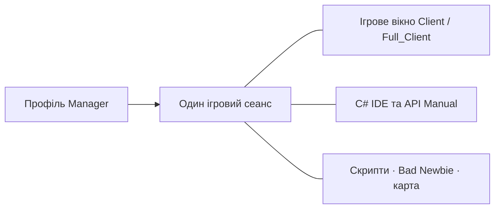

[Українська](README.md) · [English](docs/readme/en.md) · [Русский](docs/readme/ru.md) · [Deutsch](docs/readme/de.md) · [Español](docs/readme/es.md) · [Français](docs/readme/fr.md) · [Italiano](docs/readme/it.md) · [日本語](docs/readme/ja.md) · [한국어](docs/readme/ko.md) · [繁體中文](docs/readme/zh-tw.md)

---

# ClassicUO — Bad Newbie & C# Scripts IDE

Грайте в Ultima Online, керуйте персонажами та пишіть C#-скрипти в спільному робочому просторі. Bad Newbie додає допомогу з рухом, дверима, збиранням здобичі, купівлею й продажем, іменованими списками, індикаторами заклинань, шрифтами та підписами предметів.

Три програми працюють окремо й разом. Manager додає профілі, групи та спільне керування сеансами.

| Програма | Що надає | Редактор і спільні сеанси |
| --- | --- | --- |
| **Manager** | Профілі, групи, підключення, скрипти, панелі персонажа й предметів, журнали та карту | Власні C# IDE, API Manual і SessionHost; редактор і довідка працюють офлайн |
| **Full_Client** | Графічний клієнт із Bad Newbie, C#-скриптами та AutoLoad | Власний вбудований C# Scripts IDE; також працює з Manager |
| **Client** | Графічний клієнт із Bad Newbie, C#-скриптами та AutoLoad | Manager надає IDE для його чинного сеансу; Full_Client не потрібний |



Відкриття ігрового вікна з Manager використовує вже наявне підключення персонажа. IDE й панелі працюють із тим самим сеансом.

## Встановлення та перший запуск

Перевірте опубліковані завантаження в [Releases](https://github.com/LIHACHTETAN/ClassicUO-Bad-Newbie-CSharp-Scripts-IDE/releases). Повністю розпакуйте комплект у нову папку з правом запису. Додайте власні ігрові дані Ultima Online: файли гри й особисті профілі до комплекту не входять.

Запустіть `Manager/ClassicUO.Manager.exe`, `Full_Client/ClassicUO.exe` або `Client/ClassicUO.exe`. Цільова платформа — Windows x64. Готові збірки містять звичайне середовище виконання .NET; інтерфейси Manager та IDE потребують Microsoft Edge WebView2 Runtime. Для збирання програми з вихідного коду й роботи з SDK-проєктами `.csproj` потрібний .NET 10 SDK.

Перед оновленням закрийте програми та сеанси, збережіть власні профілі й скрипти, а після перенесення перевірте шляхи.

## 1. Створіть групи та профілі

Натисніть **+** біля **Groups**, введіть назву й виберіть **Save**. Виберіть групу, відкрийте її меню **⋯** і натисніть **＋ Profile**. Збережіть назву профілю, потім двічі клацніть його рядок, щоб відкрити **Profile settings**.

Укажіть адресу шарду, порт, версію UO, обліковий запис і персонажа. **Game files folder** — папка ваших даних UO. **Graphical client** вибирає `Client/ClassicUO.exe` або `Full_Client/ClassicUO.exe` із цього комплекту; це окремий шлях.

За потреби налаштуйте **C# Scripts**, **Bad Newbie** та **Script folder (Autoload)**. Меню **⋯** профілю й групи також містять копіювання. Копії мають окремі налаштування, але збережені шляхи скриптів і далі ведуть до тих самих файлів коду.

## 2. Підключіть персонажа або групу

Виберіть потрібний профіль і натисніть **▶ Connect**. Якщо автоматичний вхід вимкнено, виберіть персонажа зі списку сервера й натисніть **Enter with character**. Дочекайтеся підтвердженого входу у світ.

У меню групи **⋯** доступні **Connect entire group** і **Disconnect entire group**. Ці дії керують ігровими сеансами. **Disconnect** завершує підключення та скрипти вибраного профілю. Зміни параметрів підключення застосовуються після запуску нового сеансу.

## 3. Відкрийте IDE офлайн

Без підключення виберіть **C# IDE** у бічній панелі Manager. Manager містить власні редактор і API Manual; сусідня папка Full_Client не потрібна.

Відкрийте код через **Editor**, **New** або **Open**. Редагування, перевірка C#, компіляція, декомпіляція та довідка доступні офлайн. Дії з ігровим світом потребують активного сеансу.

Для підключеного профілю Client редактор Manager приєднується до вже наявного сеансу.

## 4. Напишіть, перевірте та запустіть скрипт

Виберіть **New → C# (.csx)** і збережіть `beginner.csx`. В активному навчальному сеансі спробуйте:

```csharp
for (int count = 1; count <= 10; count++)
{
    UO.Print($"Hello from C#! Message {count}");
    await WaitAsync(500);
}
```

Скрипт виведе десять повідомлень із півсекундною затримкою між ними. Для `.csx` не потрібні клас `Program` чи явно оголошений метод `Main`.

Натисніть **Save**, **Validate** (**F6**), потім **Start** (**F5**). Список **Select script run** визначає запуск, який ви переглядаєте. **Pause** (**F7**) під час паузи змінюється на **Continue**; **Stop** (**Shift+F5**) запитує скасування. Пауза й зупинка діють у контрольованих точках, тому сторонній блокуючий виклик може завершитися пізніше.

| Формат | Призначення |
| --- | --- |
| `.csx` | Скрипт зі змінними сеансу, зокрема `UO`, `WaitAsync` і `Cancellation` |
| `.cs` | Звичайний вихідний код C# із класами, `Main`, верхньорівневими операторами або `ICSharpScript` |
| `.csproj` | SDK-проєкт із власними вихідними файлами, залежностями й параметрами компілятора |
| `.dll` | Керований артефакт скрипта з підтримуваною точкою входу; бібліотеки можна підключати |
| `.cse` | Захищений скрипт: запускається без пароля; Encrypt і Decrypt потребують пароля |

Панель також містить **Compile**, **Decompile**, **Encrypt** і **Decrypt**. Разом із DLL скомпільованого скрипта зберігайте супровідний `.dll.csharp.json` і залежності. Decrypt відновлює захищений проєкт у вибрану порожню папку.

**AutoLoad вибирається окремо.** Кнопки **Choose…**, **Load**, **Unload** і **Reload** керують вибраним файлом персонажа. Наприклад, вибір `Autoload.csx` робить його файлом AutoLoad цього персонажа. Відкриття `beginner.csx` у редакторі саме по собі не додає його до набору наступного входу. У Manager використовуйте **Scripts → ⋯ → Save set** та AutoStart для кожного файла. AutoStart починається після входу у світ. Збереження коду не перезапускає його поточне виконання.

## 5. Знайдіть команду та приклад

Відкрийте **API Manual** із Manager або панелі IDE. Знайдіть `UO.Print`, виберіть команду й перегляньте сигнатури, параметри, результат і поведінку. Відкрийте **Examples** та скористайтеся **Copy**.

Довідник також пояснює синтаксис C#, типи, цикли, класи й асинхронний код. Перемикач мови змінює пояснення; ідентифікатори C# та UO залишаються незмінними. Панелі налагодження показують захоплені змінні й контрольні точки коду та підтримують кооперативні кроки; це не повний налагоджувач CLR.

## 6. Виберіть мову та оформлення

Натисніть шестерню вгорі: **Manager settings → Language and appearance**. Виберіть **Interface language** і **Accent color**, потім **Save**. Доступні десять мов. Manager використовує стандартну темну тему з налаштовуваним акцентом.

IDE окремо має **Theme**, вибір **Accent color** і **Reset accent**. Якщо оновлення мови відкладено, збережіть незавершені зміни та закрийте форми. Назви профілів, шляхи, вивід скриптів і серверні повідомлення зберігають початковий текст.

## 7. Відокремте та поверніть панелі

Відкрийте **Map** або **Journal** і натисніть **↗** у заголовку. **Dock** повертає відокремлену панель Manager.

В IDE відкрийте розділ через **Panels**, виберіть **Move to separate window**, а потім **Return to IDE**. **Restore layout** повертає стандартне розташування. Окремі вікна залишаються представленнями вибраного сеансу.

Закриття всього IDE зберігає завантажені файли та запущені чи призупинені скрипти. Закриття окремої вкладки коду або **Unload** зупиняє процедури цього файла й прибирає його з runtime; файл на диску залишається.

## 8. Налаштуйте спільну карту EnhancedMap

У Manager виберіть **Map → Connection**. У Client або Full_Client клацніть правою кнопкою всередині карти й виберіть **EnhancedMap server**.

Натисніть **Add**, укажіть профіль сервера карти, адресу, порт та ім’я користувача, потім **Save profiles**. Введіть пароль сервера карти й натисніть **Connect**. Типовий порт — 8887; використовуйте дані адміністратора. Це окреме підключення, відмінне від входу на ігровий шард.

Сумісний сервер EnhancedMap 2 або 3 надає **Participants** тієї самої кімнати, спільні позначки, чат і сигнали. **Show on map** центрує камеру; **Track on map** стежить за учасником, не рухаючи вашого персонажа. Адміністрування залежить від ролі сервера. Стан Online карти сам по собі не підтверджує наявність ігрової позиції.

## 9. Повторно відкрийте ігрове вікно

Для підключеного профілю Manager відкрийте меню **⋯** профілю чи картки й виберіть **▶ Open game client**. Відкрийте його **C# IDE**, щоб переглянути ті самі скрипти.

**Close game window** закриває представлення, але підключення й скрипти сеансу Manager продовжують працювати. Відкрийте вікно знову, щоб повернутися до того самого сеансу. **Disconnect** завершує сеанс. Згортання Manager у трей відрізняється від **Exit — disconnect all profiles**, що явно завершує його власні сеанси.

Докладну поведінку команд і приклади шукайте в [українській Wiki](https://github.com/LIHACHTETAN/ClassicUO-Bad-Newbie-CSharp-Scripts-IDE/wiki/Home).

Оригінальний клієнт: [ClassicUO Team](https://github.com/ClassicUO/ClassicUO). Зміни Manager, Bad Newbie та C# IDE: [проєкт Bad Newbie](https://github.com/LIHACHTETAN/ClassicUO-Bad-Newbie-CSharp-Scripts-IDE).
