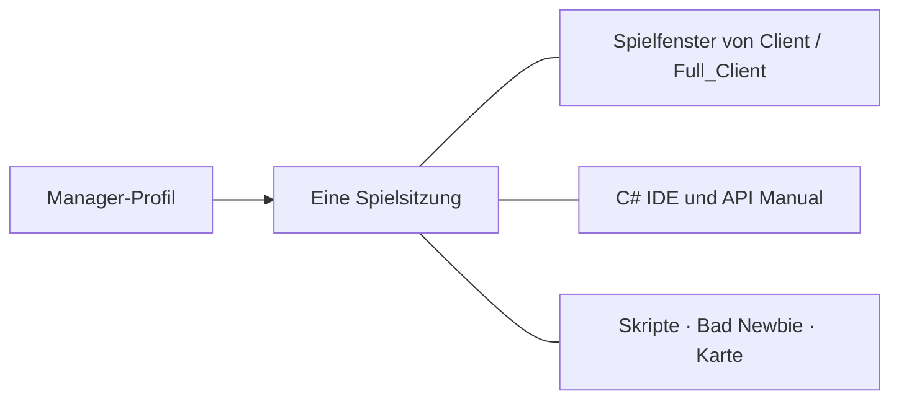

[Українська](../../README.md) · [English](en.md) · [Русский](ru.md) · [Deutsch](de.md) · [Español](es.md) · [Français](fr.md) · [Italiano](it.md) · [日本語](ja.md) · [한국어](ko.md) · [繁體中文](zh-tw.md)

---

# ClassicUO — Bad Newbie & C# Scripts IDE

Spiele Ultima Online, verwalte deine Charaktere und schreibe C#-Skripte in einem gemeinsamen Arbeitsbereich. Bad Newbie bietet praktische Hilfen für Bewegung, Türen, Beute, Kauf und Verkauf, benannte Listen, Zauberanzeigen, Schriftarten und Gegenstandsbeschriftungen.

Die drei Anwendungen lassen sich einzeln oder gemeinsam verwenden. Manager ergänzt Profile, Gruppen und eine gemeinsame Übersicht der Sitzungen.

| Anwendung | Funktionsumfang | Editor und gemeinsame Sitzungen |
| --- | --- | --- |
| **Manager** | Profile, Gruppen, Verbindungen, Skripte, Charakter- und Gegenstandsansichten, Journale und Karte | Eigene C# IDE, API Manual und SessionHost; Editor und Hilfe funktionieren auch offline |
| **Full_Client** | Grafischer Client mit Bad Newbie, C#-Skripten und AutoLoad | Eigene integrierte C# Scripts IDE; lässt sich auch mit Manager verwenden |
| **Client** | Grafischer Client mit Bad Newbie, C#-Skripten und AutoLoad | Manager stellt die IDE für die aktive Sitzung bereit; Full_Client ist dafür nicht erforderlich |



Wenn du das Spielfenster über Manager öffnest, wird die bestehende Charakterverbindung verwendet. IDE und Ansichten greifen auf dieselbe Sitzung zu.

## Installation und erster Einstieg

Verfügbare Downloads findest du unter [Veröffentlichungen](https://github.com/LIHACHTETAN/ClassicUO-Bad-Newbie-CSharp-Scripts-IDE/releases). Entpacke das vollständige Paket in einen neuen, beschreibbaren Ordner. Stelle deine eigenen Ultima-Online-Spieldaten bereit; Spieldateien und persönliche Profile sind nicht enthalten.

Starte `Manager/ClassicUO.Manager.exe`, `Full_Client/ClassicUO.exe` oder `Client/ClassicUO.exe`. Zielplattform ist Windows x64. Vorbereitete Versionen enthalten die normale .NET-Laufzeitumgebung; die Oberflächen von Manager und IDE benötigen Microsoft Edge WebView2 Runtime. Für das Erstellen aus dem Quellcode und für SDK-Projekte im Format `.csproj` wird das .NET 10 SDK benötigt.

Schließe vor einem Update Anwendungen und Sitzungen, sichere deine Profile und Skripte und überprüfe anschließend die Pfade.

## 1. Gruppen und Profile erstellen

Klicke auf **+** neben **Groups**, gib einen Namen ein und wähle **Save**. Wähle die Gruppe aus, öffne ihr Menü **⋯** und wähle **＋ Profile**. Speichere den neuen Namen und öffne anschließend mit einem Doppelklick auf die Profilzeile **Profile settings**.

Trage Serveradresse, Port, UO-Version, Konto und Charakter ein. **Game files folder** verweist auf deine UO-Daten. Unter **Graphical client** wählst du `Client/ClassicUO.exe` oder `Full_Client/ClassicUO.exe` aus diesem Paket; dieser Pfad wird getrennt angegeben.

Prüfe nach Bedarf **C# Scripts**, **Bad Newbie** und **Script folder (Autoload)**. Die Menüs **⋯** von Profilen und Gruppen bieten auch Kopierfunktionen. Kopien besitzen eigene Einstellungen; gespeicherte Skriptpfade verweisen jedoch weiterhin auf dieselben Codedateien.

## 2. Einen Charakter oder eine Gruppe verbinden

Wähle das gewünschte Profil und drücke **▶ Connect**. Ist der automatische Charaktereintritt ausgeschaltet, wähle einen vom Server gemeldeten Charakter und drücke **Enter with character**. Warte, bis der Eintritt in die Spielwelt bestätigt ist.

Das Menü **⋯** einer Gruppe bietet **Connect entire group** und **Disconnect entire group**. Diese Aktionen betreffen Spielsitzungen. **Disconnect** beendet die Verbindung und die Skripte des ausgewählten Profils. Änderungen an Verbindungseinstellungen gelten erst beim Start einer neuen Sitzung.

## 3. Die IDE offline öffnen

Wähle bei getrennter Verbindung **C# IDE** in der Seitenleiste von Manager. Manager enthält einen eigenen Editor und API Manual; eine benachbarte Full_Client-Installation ist nicht erforderlich.

Über **Editor**, **New** oder **Open** gelangst du zum Quellcode. Bearbeitung, C#-Validierung, Kompilierung, Dekompilierung und Dokumentation stehen offline zur Verfügung. Aktionen in der Spielwelt benötigen eine aktive Sitzung.

Bei einem verbundenen Client-Profil greift die IDE von Manager auf dessen bestehende Sitzung zu.

## 4. Ein Skript schreiben, prüfen und steuern

Wähle **New → C# (.csx)** und speichere `beginner.csx`. Probiere in einer aktiven Demonstrationssitzung Folgendes aus:

```csharp
for (int count = 1; count <= 10; count++)
{
    UO.Print($"Hello from C#! Message {count}");
    await WaitAsync(500);
}
```

Das Skript gibt zehn Meldungen aus und wartet dazwischen jeweils eine halbe Sekunde. Eine `.csx` benötigt weder eine Klasse `Program` noch eine ausdrücklich definierte Methode `Main`.

Wähle **Save**, **Validate** (**F6**) und anschließend **Start** (**F5**). Die Liste **Select script run** zeigt, welche Ausführung du gerade untersuchst. **Pause** (**F7**) wird im pausierten Zustand zu **Continue**; **Stop** (**Shift+F5**) fordert einen Abbruch an. Pause und Stopp greifen an kontrollierten Ausführungspunkten; blockierende externe Arbeit kann daher später enden.

| Format | Zweck |
| --- | --- |
| `.csx` | Skript mit Sitzungsvariablen und Hilfen wie `UO`, `WaitAsync` und `Cancellation` |
| `.cs` | Gewöhnlicher C#-Quellcode mit Klassen, `Main`, Anweisungen auf oberster Ebene oder `ICSharpScript` |
| `.csproj` | SDK-Projekt mit seinen Quelldateien, Abhängigkeiten und Compilereinstellungen |
| `.dll` | Verwaltetes Skriptartefakt mit unterstütztem Einstiegspunkt; Bibliotheken können referenziert werden |
| `.cse` | Geschütztes Skript: Ausführung ohne Passwort; Encrypt und Decrypt benötigen eines |

Die Symbolleiste bietet außerdem **Compile**, **Decompile**, **Encrypt** und **Decrypt**. Bewahre die Begleitdatei `.dll.csharp.json` und alle Abhängigkeiten eines kompilierten Skripts zusammen mit seiner DLL auf. Decrypt stellt ein geschütztes Projekt in einem ausgewählten leeren Ordner wieder her.

**AutoLoad wird getrennt ausgewählt.** Seine Aktionen **Choose…**, **Load**, **Unload** und **Reload** verwalten die ausgewählte Datei für den Charakter. Wählst du beispielsweise `Autoload.csx`, wird diese Datei zum AutoLoad-Eintrag des Charakters. Allein das Öffnen von `beginner.csx` im Editor fügt es nicht zum Satz für die nächste Anmeldung hinzu. Verwende in Manager **Scripts → ⋯ → Save set** und die AutoStart-Auswahl je Datei. AutoStart beginnt nach dem Eintritt in die Welt. Das Speichern von Code startet eine laufende Ausführung nicht neu.

## 5. Befehle und Beispiele finden

Öffne **API Manual** über Manager oder die IDE-Symbolleiste. Suche nach `UO.Print`, wähle den Befehl und lies seine Signaturen, Parameter, Rückgabeinformationen und sein Verhalten. Öffne **Examples** und verwende **Copy**.

Das Handbuch vermittelt auch C#-Syntax, Typen, Schleifen, Klassen und asynchronen Code. Die Sprachauswahl ändert die Erklärungen; C#- und UO-Bezeichner bleiben unverändert. Debug-Ansichten zeigen aufgezeichnete Quellcode-Prüfpunkte und Variablen mit kooperativer Einzelschrittausführung; sie sind kein vollständiger CLR-Debugger.

## 6. Sprache und Darstellung wählen

Öffne das Zahnrad in der Kopfzeile und **Manager settings → Language and appearance**. Wähle **Interface language** und **Accent color**, anschließend **Save**. Zehn Sprachen stehen zur Verfügung. Manager verwendet sein standardmäßiges dunkles Design mit einstellbarer Akzentfarbe.

Die IDE bietet getrennt davon **Theme**, eine Auswahl für **Accent color** und **Reset accent**. Speichere ausstehende Änderungen und schließe Formulare, wenn die Sprachaktualisierung zurückgestellt wird. Profilnamen, Pfade, Skriptausgaben und Servermeldungen behalten ihren ursprünglichen Text.

## 7. Ansichten auslagern und zurückholen

Öffne **Map** oder **Journal** und verwende **↗** in der Überschrift. **Dock** bringt die ausgelagerte Manager-Ansicht zurück.

Öffne in der IDE eine Ansicht über **Panels**, wähle **Move to separate window** und anschließend **Return to IDE**. **Restore layout** stellt die Standardanordnung wieder her. Ausgelagerte Fenster bleiben Ansichten der ausgewählten Sitzung.

Das Schließen der gesamten IDE erhält geladene Dateien sowie laufende und pausierte Skripte. Das Schließen einer einzelnen Quellcode-Registerkarte oder **Unload** beendet die Prozeduren dieser Datei und entfernt sie aus der Laufzeitumgebung; die Datei bleibt auf dem Datenträger erhalten.

## 8. Gemeinsame Nutzung von EnhancedMap einrichten

Verwende in Manager **Map → Connection**. Klicke in Client oder Full_Client mit der rechten Maustaste in die Karte und wähle **EnhancedMap server**.

Wähle **Add**, trage Profil, Adresse, Port und Benutzernamen des Kartenservers ein und wähle **Save profiles**. Gib das Passwort des Kartenservers ein und wähle **Connect**. Der Standardport ist 8887; verwende die tatsächlichen Einstellungen deines Administrators. Diese Verbindung ist von der zum Spielserver getrennt.

Ein kompatibler EnhancedMap-2- oder -3-Server liefert **Participants** desselben Raums, gemeinsame Beschriftungen, Chat und Warnungen. **Show on map** zentriert die Kamera; **Track on map** folgt einem Teilnehmer, ohne deinen Charakter zu bewegen. Serverrollen steuern die Verwaltungsfunktionen. Eine Kartenverbindung mit dem Zustand Online belegt allein keine verfügbare Spielposition.

## 9. Das grafische Fenster erneut öffnen

Öffne für ein verbundenes Manager-Profil das Menü **⋯** des Profils beziehungsweise seiner Karte und wähle **▶ Open game client**. Öffne dessen **C# IDE**, um dieselben Skripte anzusehen.

**Close game window** schließt diese Ansicht, während die von Manager verwaltete Verbindung und die Skripte weiterlaufen. Öffne sie erneut, um zur selben Sitzung zurückzukehren. **Disconnect** beendet die Sitzung. Das Schließen von Manager in den Infobereich unterscheidet sich von **Exit — disconnect all profiles**; dieser Befehl beendet ausdrücklich die verwalteten Sitzungen.

Im [deutschen Wiki](https://github.com/LIHACHTETAN/ClassicUO-Bad-Newbie-CSharp-Scripts-IDE/wiki/DE-Home) findest du weitere Erklärungen zum Verhalten der Befehle und Beispiele.

Ursprünglicher Client: [ClassicUO Team](https://github.com/ClassicUO/ClassicUO). Erweiterungen für Manager, Bad Newbie und C# IDE: [Bad-Newbie-Projekt](https://github.com/LIHACHTETAN/ClassicUO-Bad-Newbie-CSharp-Scripts-IDE).
