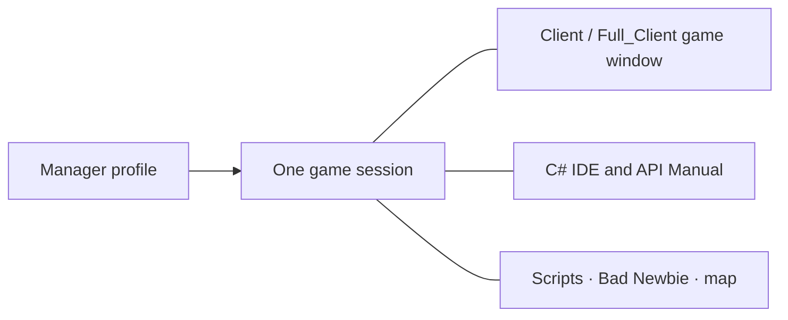

[Українська](../../README.md) · [English](en.md) · [Русский](ru.md) · [Deutsch](de.md) · [Español](es.md) · [Français](fr.md) · [Italiano](it.md) · [日本語](ja.md) · [한국어](ko.md) · [繁體中文](zh-tw.md)

---

# ClassicUO — Bad Newbie & C# Scripts IDE

Play Ultima Online, organize characters, and write C# scripts in one connected workspace. Bad Newbie adds practical assistance for movement, doors, loot, buying and selling, named lists, casting indicators, fonts and item labels.

The three applications work independently or together. Manager adds profiles, groups and a shared view of sessions.

| Application | What it provides | Editor and shared sessions |
| --- | --- | --- |
| **Manager** | Profiles, groups, connections, scripts, character and item panels, journals and map | Its own C# IDE, API Manual and SessionHost; editor and help work offline |
| **Full_Client** | Graphical client with Bad Newbie, C# scripts and AutoLoad | Its own integrated C# Scripts IDE; also works with Manager |
| **Client** | Graphical client with Bad Newbie, C# scripts and AutoLoad | Manager supplies the IDE for its active session; Full_Client is not required |



Opening a game window from Manager uses the existing character connection. The IDE and panels see that same session.

## Install and choose a starting point

Check [Releases](https://github.com/LIHACHTETAN/ClassicUO-Bad-Newbie-CSharp-Scripts-IDE/releases) for published downloads. Extract the complete package into a new writable folder. Supply your own Ultima Online game data; game files and personal profiles are not included.

Run `Manager/ClassicUO.Manager.exe`, `Full_Client/ClassicUO.exe` or `Client/ClassicUO.exe`. The target is Windows x64. Prepared builds include the ordinary .NET runtime; Manager and IDE interfaces require Microsoft Edge WebView2 Runtime. Building the product from source and working with SDK-style `.csproj` projects require .NET 10 SDK.

For updates, close applications and sessions first, preserve your profiles and scripts, then check the paths.

## 1. Create groups and profiles

Use **+** beside **Groups**, enter a name and choose **Save**. Select the group, open its **⋯** menu and choose **＋ Profile**. Save the new name, then double-click the profile row to open **Profile settings**.

Set the shard address, port, UO version, account and character. **Game files folder** points to your UO data. **Graphical client** selects this package's `Client/ClassicUO.exe` or `Full_Client/ClassicUO.exe`; it is a separate path.

Check **C# Scripts**, **Bad Newbie**, and **Script folder (Autoload)** as needed. Profile and group **⋯** menus also offer copying. Copies have separate settings, but saved script paths still refer to the same code files.

## 2. Connect a character or group

Select the intended profile and press **▶ Connect**. If automatic character entry is off, choose a character returned by the server and press **Enter with character**. Wait for confirmed world entry.

A group's **⋯** menu offers **Connect entire group** and **Disconnect entire group**. These actions concern game sessions. **Disconnect** ends the selected profile's connection and scripts. Connection-setting changes take effect after starting a new session.

## 3. Open the IDE offline

Choose **C# IDE** in Manager's sidebar while disconnected. Manager includes its own editor and API Manual; no adjacent Full_Client installation is needed.

Use **Editor**, **New** or **Open** to reach your source. Editing, C# validation, compilation, decompilation and documentation are available offline. Actions involving the game world require an active session.

With a connected Client profile, Manager's IDE attaches to that existing session.

## 4. Write, validate and control a script

Choose **New → C# (.csx)** and save `beginner.csx`. In an active demonstration session, try:

```csharp
for (int count = 1; count <= 10; count++)
{
    UO.Print($"Hello from C#! Message {count}");
    await WaitAsync(500);
}
```

This prints ten messages, waiting half a second between them. A `.csx` does not need a `Program` class or an explicit `Main` method.

Choose **Save**, **Validate** (**F6**), then **Start** (**F5**). The **Select script run** list identifies the execution being inspected. **Pause** (**F7**) becomes **Continue** while paused; **Stop** (**Shift+F5**) requests cancellation. Pause and Stop act at controlled points, so external blocking work may finish later.

| Format | Purpose |
| --- | --- |
| `.csx` | Script with session globals such as `UO`, `WaitAsync` and `Cancellation` |
| `.cs` | Ordinary C# source using classes, `Main`, top-level code or `ICSharpScript` |
| `.csproj` | SDK project with its sources, dependencies and compiler settings |
| `.dll` | Managed script artifact with a supported entry point; libraries can be referenced |
| `.cse` | Protected script: run without a password; Encrypt and Decrypt require one |

The toolbar also offers **Compile**, **Decompile**, **Encrypt** and **Decrypt**. Keep a compiled script's `.dll.csharp.json` companion and dependencies with its DLL. Decrypt restores a protected project into a chosen empty folder.

**AutoLoad is a separate choice.** Its **Choose…**, **Load**, **Unload** and **Reload** controls manage the selected file for the character. For example, selecting an `Autoload.csx` file makes that file the character's AutoLoad entry. Opening `beginner.csx` in the editor alone does not put it in the next-login set. In Manager, use **Scripts → ⋯ → Save set** and per-file AutoStart choices. AutoStart begins after entering the world. Saving code does not restart its current run.

## 5. Find commands and examples

Open **API Manual** from Manager or the IDE toolbar. Search for `UO.Print`, select the command, then read its signatures, parameters, return information and behavior. Open **Examples** and use **Copy**.

The manual also teaches C# syntax, types, loops, classes and asynchronous code. Its language selector changes explanations; C# and UO identifiers remain unchanged. Debug views show captured source checkpoints and variables, with cooperative stepping; they are not a full CLR debugger.

## 6. Choose language and appearance

Open the header gear, **Manager settings → Language and appearance**. Choose **Interface language** and **Accent color**, then **Save**. Ten languages are available. Manager uses its default dark theme with a configurable accent.

The IDE separately offers **Theme**, an **Accent color** picker and **Reset accent**. Save pending edits and close forms if a language refresh is deferred. Profile names, paths, script output and server messages retain their original text.

## 7. Detach and restore panels

Open **Map** or **Journal** and use its **↗** heading control. **Dock** returns the detached Manager panel.

In the IDE, open a view through **Panels**, then choose **Move to separate window** and **Return to IDE**. **Restore layout** restores the standard arrangement. Detached windows remain views of the selected session.

Closing the whole IDE preserves loaded files and running or paused scripts. Closing an individual source tab or choosing **Unload** stops that file's procedures and removes it from runtime; the disk file remains.

## 8. Configure EnhancedMap sharing

In Manager use **Map → Connection**. In Client or Full_Client, right-click inside the map and choose **EnhancedMap server**.

Choose **Add**, fill the map-server profile, address, port and user name, then **Save profiles**. Enter the map-server password and **Connect**. The default port is 8887; use your administrator's actual settings. This is a separate connection from the game shard.

A compatible EnhancedMap 2 or 3 server supplies same-room **Participants**, shared labels, chat and alerts. **Show on map** centers the camera; **Track on map** follows a participant without moving your character. Server roles control administration. An Online map connection alone does not prove an available game position.

## 9. Reopen the graphical window

For a connected Manager profile, open the profile/card **⋯** menu and choose **▶ Open game client**. Open its **C# IDE** to inspect the same scripts.

**Close game window** closes that view while the Manager-owned connection and scripts continue. Reopen it to return to the same session. **Disconnect** ends the session. Closing Manager to its tray differs from **Exit — disconnect all profiles**, which explicitly shuts down its owned sessions.

Continue with the [English Wiki](https://github.com/LIHACHTETAN/ClassicUO-Bad-Newbie-CSharp-Scripts-IDE/wiki/EN-Home) for detailed command behavior and examples.

Original client: [ClassicUO Team](https://github.com/ClassicUO/ClassicUO). Manager, Bad Newbie and C# IDE modifications: [Bad Newbie project](https://github.com/LIHACHTETAN/ClassicUO-Bad-Newbie-CSharp-Scripts-IDE).
