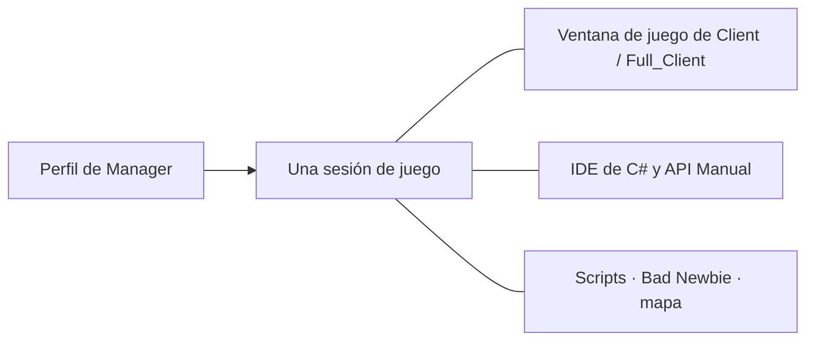

[Українська](../../README.md) · [English](en.md) · [Русский](ru.md) · [Deutsch](de.md) · [Español](es.md) · [Français](fr.md) · [Italiano](it.md) · [日本語](ja.md) · [한국어](ko.md) · [繁體中文](zh-tw.md)

---

# ClassicUO — Bad Newbie & C# Scripts IDE

Juega a Ultima Online, organiza tus personajes y escribe scripts de C# en un mismo espacio de trabajo conectado. Bad Newbie incorpora ayudas prácticas para el movimiento, las puertas, el botín, la compraventa, las listas con nombre, los indicadores de lanzamiento de hechizos, las fuentes y las etiquetas de objetos.

Las tres aplicaciones pueden utilizarse de forma independiente o conjunta. Manager añade perfiles, grupos y una vista compartida de las sesiones.

| Aplicación | Qué ofrece | Editor y sesiones compartidas |
| --- | --- | --- |
| **Manager** | Perfiles, grupos, conexiones, scripts, paneles de personajes y objetos, diarios y mapa | Su propio IDE de C#, API Manual y SessionHost; el editor y la ayuda funcionan sin conexión |
| **Full_Client** | Cliente gráfico con Bad Newbie, scripts de C# y AutoLoad | Su propio C# Scripts IDE integrado; también funciona con Manager |
| **Client** | Cliente gráfico con Bad Newbie, scripts de C# y AutoLoad | Manager proporciona el IDE para su sesión activa; no necesita Full_Client |



Al abrir una ventana de juego desde Manager, se utiliza la conexión existente del personaje. El IDE y los paneles acceden a esa misma sesión.

## Instala y elige por dónde empezar

Consulta [Lanzamientos](https://github.com/LIHACHTETAN/ClassicUO-Bad-Newbie-CSharp-Scripts-IDE/releases) para encontrar las descargas publicadas. Extrae el paquete completo en una carpeta nueva con permisos de escritura. Debes aportar tus propios datos de Ultima Online; no se incluyen archivos del juego ni perfiles personales.

Ejecuta `Manager/ClassicUO.Manager.exe`, `Full_Client/ClassicUO.exe` o `Client/ClassicUO.exe`. La plataforma de destino es Windows x64. Las compilaciones preparadas incluyen el entorno de ejecución habitual de .NET; las interfaces de Manager y del IDE requieren Microsoft Edge WebView2 Runtime. Para compilar el producto desde el código fuente y trabajar con proyectos `.csproj` de estilo SDK, se necesita .NET 10 SDK.

Para actualizar, cierra primero las aplicaciones y las sesiones, conserva tus perfiles y scripts y comprueba las rutas.

## 1. Crea grupos y perfiles

Usa **+** junto a **Groups**, introduce un nombre y selecciona **Save**. Selecciona el grupo, abre su menú **⋯** y elige **＋ Profile**. Guarda el nuevo nombre y haz doble clic en la fila del perfil para abrir **Profile settings**.

Configura la dirección del servidor, el puerto, la versión de UO, la cuenta y el personaje. **Game files folder** indica dónde están tus datos de UO. **Graphical client** selecciona `Client/ClassicUO.exe` o `Full_Client/ClassicUO.exe` de este paquete; es una ruta distinta.

Activa **C# Scripts**, **Bad Newbie** y configura **Script folder (Autoload)** según lo necesites. Los menús **⋯** de perfiles y grupos también permiten copiarlos. Las copias tienen ajustes independientes, pero las rutas de scripts guardadas siguen apuntando a los mismos archivos de código.

## 2. Conecta un personaje o un grupo

Selecciona el perfil que quieras utilizar y pulsa **▶ Connect**. Si la entrada automática del personaje está desactivada, elige uno de los personajes devueltos por el servidor y pulsa **Enter with character**. Espera a que se confirme la entrada en el mundo.

El menú **⋯** de un grupo ofrece **Connect entire group** y **Disconnect entire group**. Estas acciones afectan a las sesiones de juego. **Disconnect** finaliza la conexión y los scripts del perfil seleccionado. Los cambios de conexión se aplican al iniciar una sesión nueva.

## 3. Abre el IDE sin conexión

Con el perfil desconectado, elige **C# IDE** en la barra lateral de Manager. Manager incluye su propio editor y API Manual; no requiere una instalación de Full_Client junto a él.

Utiliza **Editor**, **New** u **Open** para acceder al código fuente. Puedes editar, validar C#, compilar, descompilar y consultar la documentación sin conexión. Las acciones que afectan al mundo del juego requieren una sesión activa.

Si el perfil de Client está conectado, el IDE de Manager se vincula a esa sesión existente.

## 4. Escribe, valida y controla un script

Elige **New → C# (.csx)** y guarda `beginner.csx`. En una sesión de demostración activa, prueba:

```csharp
for (int count = 1; count <= 10; count++)
{
    UO.Print($"Hello from C#! Message {count}");
    await WaitAsync(500);
}
```

Este código muestra diez mensajes y espera medio segundo entre ellos. Un archivo `.csx` no necesita una clase `Program` ni un método `Main` explícito.

Selecciona **Save**, **Validate** (**F6**) y después **Start** (**F5**). La lista **Select script run** identifica la ejecución que estás examinando. **Pause** (**F7**) se convierte en **Continue** mientras está en pausa; **Stop** (**Shift+F5**) solicita su cancelación. La pausa y la detención se aplican en puntos controlados, por lo que una operación externa bloqueante puede terminar más tarde.

| Formato | Finalidad |
| --- | --- |
| `.csx` | Script con variables globales de la sesión, como `UO`, `WaitAsync` y `Cancellation` |
| `.cs` | Código C# habitual con clases, `Main`, código de nivel superior o `ICSharpScript` |
| `.csproj` | Proyecto de SDK con sus archivos fuente, dependencias y ajustes del compilador |
| `.dll` | Artefacto de script administrado con un punto de entrada compatible; permite referenciar bibliotecas |
| `.cse` | Script protegido: se ejecuta sin contraseña; Encrypt y Decrypt sí requieren una |

La barra de herramientas también ofrece **Compile**, **Decompile**, **Encrypt** y **Decrypt**. Conserva el archivo complementario `.dll.csharp.json` y las dependencias del script compilado junto a su DLL. Decrypt restaura un proyecto protegido en una carpeta vacía que hayas elegido.

**AutoLoad se configura por separado.** Sus controles **Choose…**, **Load**, **Unload** y **Reload** administran el archivo seleccionado para el personaje. Por ejemplo, seleccionar un archivo `Autoload.csx` lo convierte en la entrada de AutoLoad del personaje. Abrir `beginner.csx` en el editor no lo añade por sí solo al conjunto del siguiente inicio de sesión. En Manager utiliza **Scripts → ⋯ → Save set** y las opciones AutoStart de cada archivo. AutoStart comienza después de entrar en el mundo. Guardar el código no reinicia una ejecución que ya esté activa.

## 5. Encuentra comandos y ejemplos

Abre **API Manual** desde Manager o la barra de herramientas del IDE. Busca `UO.Print`, selecciona el comando y lee sus firmas, parámetros, información de retorno y comportamiento. Abre **Examples** y utiliza **Copy**.

El manual también enseña sintaxis de C#, tipos, bucles, clases y código asíncrono. Su selector de idioma cambia las explicaciones; los identificadores de C# y UO permanecen iguales. Las vistas de depuración muestran puntos de control y variables capturados del código fuente, con ejecución paso a paso cooperativa; no constituyen un depurador CLR completo.

## 6. Elige el idioma y la apariencia

Abre el engranaje de la cabecera, **Manager settings → Language and appearance**. Elige **Interface language** y **Accent color** y pulsa **Save**. Hay diez idiomas disponibles. Manager utiliza su tema oscuro predeterminado con un color de acento configurable.

El IDE dispone de sus propios controles **Theme**, selector **Accent color** y **Reset accent**. Guarda los cambios pendientes y cierra los formularios si se aplaza la actualización del idioma. Los nombres de perfiles, rutas, salida de scripts y mensajes del servidor conservan su texto original.

## 7. Separa y restaura paneles

Abre **Map** o **Journal** y utiliza el control **↗** de su cabecera. **Dock** devuelve el panel separado a Manager.

En el IDE, abre una vista mediante **Panels** y elige **Move to separate window** y **Return to IDE**. **Restore layout** recupera la disposición estándar. Las ventanas separadas siguen siendo vistas de la sesión seleccionada.

Cerrar todo el IDE conserva los archivos cargados y los scripts que estén ejecutándose o en pausa. Cerrar una pestaña de código individual o elegir **Unload** detiene los procedimientos de ese archivo y lo retira del entorno de ejecución; el archivo permanece en el disco.

## 8. Configura el uso compartido de EnhancedMap

En Manager utiliza **Map → Connection**. En Client o Full_Client, haz clic con el botón derecho dentro del mapa y elige **EnhancedMap server**.

Selecciona **Add**, rellena el perfil, la dirección, el puerto y el nombre de usuario del servidor de mapas y pulsa **Save profiles**. Introduce la contraseña del servidor de mapas y selecciona **Connect**. El puerto predeterminado es 8887; utiliza los datos reales proporcionados por su administrador. Esta conexión es independiente de la del servidor del juego.

Un servidor EnhancedMap 2 o 3 compatible proporciona **Participants** de la misma sala, etiquetas compartidas, chat y alertas. **Show on map** centra la cámara; **Track on map** sigue a un participante sin mover tu personaje. Las funciones de administración dependen de los roles del servidor. Una conexión de mapa Online no demuestra por sí sola que exista una posición de juego disponible.

## 9. Vuelve a abrir la ventana gráfica

Con un perfil de Manager conectado, abre el menú **⋯** del perfil o de su tarjeta y selecciona **▶ Open game client**. Abre su **C# IDE** para examinar los mismos scripts.

**Close game window** cierra esa vista mientras la conexión y los scripts gestionados por Manager continúan. Vuelve a abrirla para regresar a la misma sesión. **Disconnect** finaliza la sesión. Cerrar Manager a la bandeja del sistema es distinto de **Exit — disconnect all profiles**, que cierra explícitamente las sesiones que gestiona.

Continúa con la [Wiki en español](https://github.com/LIHACHTETAN/ClassicUO-Bad-Newbie-CSharp-Scripts-IDE/wiki/ES-Home) para consultar el comportamiento detallado de los comandos y sus ejemplos.

Cliente original: [ClassicUO Team](https://github.com/ClassicUO/ClassicUO). Modificaciones de Manager, Bad Newbie y el IDE de C#: [proyecto Bad Newbie](https://github.com/LIHACHTETAN/ClassicUO-Bad-Newbie-CSharp-Scripts-IDE).
