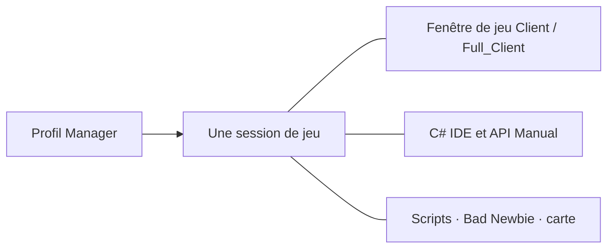

[Українська](../../README.md) · [English](en.md) · [Русский](ru.md) · [Deutsch](de.md) · [Español](es.md) · [Français](fr.md) · [Italiano](it.md) · [日本語](ja.md) · [한국어](ko.md) · [繁體中文](zh-tw.md)

---

# ClassicUO — Bad Newbie & C# Scripts IDE

Jouez à Ultima Online, organisez vos personnages et écrivez des scripts C# dans un espace commun. Bad Newbie facilite les déplacements, les portes, le butin, les achats et ventes, les listes nommées, les indicateurs d’incantation, les polices et les étiquettes d’objets.

Les trois applications fonctionnent seules ou ensemble. Manager ajoute profils, groupes et suivi commun des sessions.

| Application | Fonctions | Éditeur et sessions partagées |
| --- | --- | --- |
| **Manager** | Profils, groupes, connexions, scripts, panneaux des personnages et objets, journaux et carte | Ses propres C# IDE, API Manual et SessionHost ; éditeur et aide disponibles hors connexion |
| **Full_Client** | Client graphique avec Bad Newbie, scripts C# et AutoLoad | Sa propre C# Scripts IDE intégrée ; fonctionne aussi avec Manager |
| **Client** | Client graphique avec Bad Newbie, scripts C# et AutoLoad | Manager fournit l’IDE de sa session active ; Full_Client n’est pas nécessaire |



Ouvrir une fenêtre de jeu depuis Manager utilise la connexion du personnage existante. L’IDE et les panneaux accèdent à cette même session.

## Installation et premiers pas

Consultez les [versions publiées](https://github.com/LIHACHTETAN/ClassicUO-Bad-Newbie-CSharp-Scripts-IDE/releases) pour télécharger le logiciel. Extrayez le paquet complet dans un nouveau dossier accessible en écriture. Fournissez vos propres données Ultima Online ; les fichiers du jeu et profils personnels ne sont pas inclus.

Lancez `Manager/ClassicUO.Manager.exe`, `Full_Client/ClassicUO.exe` ou `Client/ClassicUO.exe`. La plateforme cible est Windows x64. Les versions préparées incluent l’environnement d’exécution .NET habituel ; les interfaces de Manager et de l’IDE nécessitent Microsoft Edge WebView2 Runtime. Compiler le produit depuis ses sources ou travailler sur des projets SDK `.csproj` nécessite le SDK .NET 10.

Avant une mise à jour, fermez applications et sessions, conservez vos profils et scripts, puis vérifiez les chemins.

## 1. Créer des groupes et profils

Cliquez sur **+** près de **Groups**, saisissez un nom et choisissez **Save**. Sélectionnez le groupe, ouvrez son menu **⋯**, puis **＋ Profile**. Enregistrez le nouveau nom et double-cliquez sur la ligne du profil pour ouvrir **Profile settings**.

Renseignez adresse du serveur, port, version UO, compte et personnage. **Game files folder** désigne vos données UO. **Graphical client** sélectionne `Client/ClassicUO.exe` ou `Full_Client/ClassicUO.exe` de ce paquet ; ce chemin est distinct.

Vérifiez **C# Scripts**, **Bad Newbie** et **Script folder (Autoload)** selon vos besoins. Les menus **⋯** des profils et groupes permettent aussi la copie. Les copies ont leurs propres paramètres, mais leurs chemins de scripts désignent toujours les mêmes fichiers de code.

## 2. Connecter un personnage ou groupe

Sélectionnez le profil voulu et cliquez sur **▶ Connect**. Si l’entrée automatique est désactivée, choisissez un personnage renvoyé par le serveur, puis **Enter with character**. Attendez la confirmation de son entrée dans le monde.

Le menu **⋯** d’un groupe propose **Connect entire group** et **Disconnect entire group**. Ces actions concernent les sessions de jeu. **Disconnect** termine la connexion et les scripts du profil sélectionné. Les changements de connexion prennent effet au démarrage d’une nouvelle session.

## 3. Ouvrir l’IDE hors connexion

Sans connexion active, choisissez **C# IDE** dans la barre latérale de Manager. Manager possède son propre éditeur et API Manual ; aucune installation Full_Client voisine n’est nécessaire.

Accédez au code avec **Editor**, **New** ou **Open**. Édition, validation C#, compilation, décompilation et documentation sont disponibles hors connexion. Les actions sur le monde du jeu nécessitent une session active.

Avec un profil Client connecté, l’IDE de Manager rejoint cette session existante.

## 4. Écrire, valider et contrôler un script

Choisissez **New → C# (.csx)** et enregistrez `beginner.csx`. Dans une session de démonstration active, essayez :

```csharp
for (int count = 1; count <= 10; count++)
{
    UO.Print($"Hello from C#! Message {count}");
    await WaitAsync(500);
}
```

Ce script affiche dix messages espacés d’une demi-seconde. Un `.csx` ne nécessite ni classe `Program`, ni méthode `Main` explicite.

Choisissez **Save**, **Validate** (**F6**), puis **Start** (**F5**). **Select script run** identifie l’exécution inspectée. **Pause** (**F7**) devient **Continue** pendant la pause ; **Stop** (**Shift+F5**) demande l’annulation. Pause et arrêt interviennent à des points contrôlés : une opération externe bloquante peut finir plus tard.

| Format | Utilisation |
| --- | --- |
| `.csx` | Script avec les éléments de session tels que `UO`, `WaitAsync` et `Cancellation` |
| `.cs` | Source C# ordinaire avec classes, `Main`, instructions de premier niveau ou `ICSharpScript` |
| `.csproj` | Projet SDK avec ses sources, dépendances et paramètres de compilation |
| `.dll` | Script compilé managé avec point d’entrée pris en charge ; bibliothèques référençables |
| `.cse` | Script protégé : exécution sans mot de passe ; Encrypt et Decrypt en exigent un |

La barre propose aussi **Compile**, **Decompile**, **Encrypt** et **Decrypt**. Conservez le fichier associé `.dll.csharp.json` et les dépendances du script compilé avec sa DLL. Decrypt restaure un projet protégé dans un dossier vide choisi.

**AutoLoad se sélectionne séparément.** **Choose…**, **Load**, **Unload** et **Reload** gèrent le fichier choisi pour le personnage. Sélectionner `Autoload.csx`, par exemple, en fait son fichier AutoLoad. Ouvrir `beginner.csx` dans l’éditeur ne l’ajoute pas à l’ensemble de la prochaine connexion. Dans Manager, utilisez **Scripts → ⋯ → Save set** et les choix AutoStart par fichier. AutoStart démarre après l’entrée dans le monde. Enregistrer le code ne redémarre pas son exécution actuelle.

## 5. Trouver commandes et exemples

Ouvrez **API Manual** depuis Manager ou la barre de l’IDE. Recherchez `UO.Print`, sélectionnez la commande et lisez signatures, paramètres, informations de retour et comportement. Ouvrez **Examples**, puis **Copy**.

Le manuel enseigne aussi syntaxe C#, types, boucles, classes et code asynchrone. Son sélecteur de langue change les explications ; les identifiants C# et UO restent inchangés. Les vues de débogage présentent points de contrôle et variables capturés, avec progression coopérative ; ce n’est pas un débogueur CLR complet.

## 6. Choisir langue et apparence

Ouvrez l’engrenage supérieur, **Manager settings → Language and appearance**. Choisissez **Interface language** et **Accent color**, puis **Save**. Dix langues sont disponibles. Manager utilise son thème sombre par défaut avec une couleur d’accent réglable.

L’IDE propose séparément **Theme**, le sélecteur **Accent color** et **Reset accent**. Enregistrez vos modifications et fermez les formulaires si le changement de langue est différé. Noms de profils, chemins, sorties des scripts et messages du serveur conservent leur texte original.

## 7. Détacher et réintégrer les panneaux

Ouvrez **Map** ou **Journal**, puis utilisez **↗** dans son titre. **Dock** réintègre le panneau Manager détaché.

Dans l’IDE, ouvrez une vue par **Panels**, puis choisissez **Move to separate window** et **Return to IDE**. **Restore layout** rétablit la disposition standard. Les fenêtres détachées restent des vues de la session sélectionnée.

Fermer toute l’IDE préserve les fichiers chargés et les scripts actifs ou en pause. Fermer un onglet source ou choisir **Unload** arrête les procédures de ce fichier et le retire de l’environnement d’exécution ; le fichier sur disque demeure intact.

## 8. Configurer le partage EnhancedMap

Dans Manager, utilisez **Map → Connection**. Dans Client ou Full_Client, faites un clic droit dans la carte et choisissez **EnhancedMap server**.

Choisissez **Add**, renseignez profil, adresse, port et nom d’utilisateur du serveur cartographique, puis **Save profiles**. Saisissez son mot de passe et choisissez **Connect**. Le port par défaut est 8887 ; utilisez les paramètres réels fournis par l’administrateur. Cette connexion est distincte du serveur de jeu.

Un serveur EnhancedMap 2 ou 3 compatible fournit les **Participants** du même salon, étiquettes partagées, discussion et alertes. **Show on map** centre la caméra ; **Track on map** suit un participant sans déplacer votre personnage. Les rôles du serveur régissent l’administration. Une connexion cartographique Online ne prouve pas seule la disponibilité d’une position en jeu.

## 9. Rouvrir la fenêtre graphique

Pour un profil Manager connecté, ouvrez le menu **⋯** du profil ou de sa fiche, puis **▶ Open game client**. Ouvrez sa **C# IDE** pour inspecter les mêmes scripts.

**Close game window** ferme cette vue tandis que connexion et scripts gérés par Manager continuent. Rouvrez-la pour retrouver la même session. **Disconnect** termine la session. Fermer Manager dans la zone de notification diffère de **Exit — disconnect all profiles**, qui arrête explicitement ses sessions.

Consultez le [Wiki français](https://github.com/LIHACHTETAN/ClassicUO-Bad-Newbie-CSharp-Scripts-IDE/wiki/FR-Home) pour approfondir le comportement des commandes et leurs exemples.

Client original : [ClassicUO Team](https://github.com/ClassicUO/ClassicUO). Modifications de Manager, Bad Newbie et C# IDE : [projet Bad Newbie](https://github.com/LIHACHTETAN/ClassicUO-Bad-Newbie-CSharp-Scripts-IDE).
