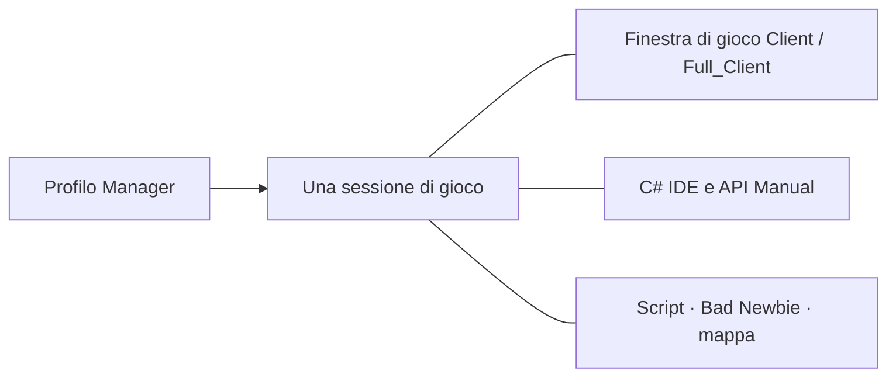

[Українська](../../README.md) · [English](en.md) · [Русский](ru.md) · [Deutsch](de.md) · [Español](es.md) · [Français](fr.md) · [Italiano](it.md) · [日本語](ja.md) · [한국어](ko.md) · [繁體中文](zh-tw.md)

---

# ClassicUO — Bad Newbie & C# Scripts IDE

Gioca a Ultima Online, organizza i personaggi e scrivi script C# in uno spazio di lavoro comune. Bad Newbie offre aiuti pratici per movimento, porte, bottino, acquisti e vendite, elenchi con nome, indicatori di lancio degli incantesimi, caratteri ed etichette degli oggetti.

Le tre applicazioni funzionano da sole o insieme. Manager aggiunge profili, gruppi e una vista comune delle sessioni.

| Applicazione | Funzioni | Editor e sessioni condivise |
| --- | --- | --- |
| **Manager** | Profili, gruppi, connessioni, script, pannelli di personaggi e oggetti, diari e mappa | C# IDE, API Manual e SessionHost propri; editor e guida funzionano anche senza connessione |
| **Full_Client** | Client grafico con Bad Newbie, script C# e AutoLoad | C# Scripts IDE integrata; funziona anche con Manager |
| **Client** | Client grafico con Bad Newbie, script C# e AutoLoad | Manager fornisce l’IDE per la sessione attiva; Full_Client non è necessario |



Aprire una finestra di gioco da Manager usa la connessione esistente del personaggio. L’IDE e i pannelli accedono alla stessa sessione.

## Installazione e primi passi

Consulta le [versioni pubblicate](https://github.com/LIHACHTETAN/ClassicUO-Bad-Newbie-CSharp-Scripts-IDE/releases) per i download disponibili. Estrai il pacchetto completo in una nuova cartella scrivibile. Fornisci i tuoi dati di Ultima Online; file di gioco e profili personali non sono inclusi.

Avvia `Manager/ClassicUO.Manager.exe`, `Full_Client/ClassicUO.exe` o `Client/ClassicUO.exe`. La piattaforma di riferimento è Windows x64. Le versioni preparate includono il normale ambiente di esecuzione .NET; le interfacce di Manager e dell’IDE richiedono Microsoft Edge WebView2 Runtime. Compilare il prodotto dai sorgenti e lavorare con progetti SDK `.csproj` richiede .NET 10 SDK.

Prima di un aggiornamento, chiudi applicazioni e sessioni, conserva profili e script, quindi verifica i percorsi.

## 1. Creare gruppi e profili

Usa **+** accanto a **Groups**, inserisci un nome e scegli **Save**. Seleziona il gruppo, apri il menu **⋯** e scegli **＋ Profile**. Salva il nuovo nome, poi fai doppio clic sulla riga del profilo per aprire **Profile settings**.

Imposta indirizzo del server, porta, versione UO, account e personaggio. **Game files folder** indica i tuoi dati UO. **Graphical client** seleziona `Client/ClassicUO.exe` o `Full_Client/ClassicUO.exe` da questo pacchetto; è un percorso distinto.

Controlla **C# Scripts**, **Bad Newbie** e **Script folder (Autoload)** secondo necessità. I menu **⋯** di profili e gruppi offrono anche la copia. Le copie hanno impostazioni separate, ma i percorsi degli script continuano a indicare gli stessi file di codice.

## 2. Connettere un personaggio o gruppo

Seleziona il profilo desiderato e premi **▶ Connect**. Se l’ingresso automatico è disattivato, scegli un personaggio restituito dal server e premi **Enter with character**. Attendi la conferma dell’ingresso nel mondo.

Il menu **⋯** di un gruppo offre **Connect entire group** e **Disconnect entire group**. Queste azioni riguardano le sessioni di gioco. **Disconnect** termina connessione e script del profilo selezionato. Le modifiche alle impostazioni di connessione entrano in vigore avviando una nuova sessione.

## 3. Aprire l’IDE senza connessione

Scegli **C# IDE** nella barra laterale di Manager mentre sei disconnesso. Manager include editor e API Manual propri; non serve un’installazione Full_Client accanto a Manager.

Usa **Editor**, **New** o **Open** per accedere ai sorgenti. Modifica, verifica C#, compilazione, decompilazione e documentazione sono disponibili senza connessione. Le azioni sul mondo di gioco richiedono una sessione attiva.

Con un profilo Client connesso, l’IDE di Manager si collega alla sessione esistente.

## 4. Scrivere, verificare e controllare uno script

Scegli **New → C# (.csx)** e salva `beginner.csx`. In una sessione dimostrativa attiva, prova:

```csharp
for (int count = 1; count <= 10; count++)
{
    UO.Print($"Hello from C#! Message {count}");
    await WaitAsync(500);
}
```

Questo script stampa dieci messaggi, attendendo mezzo secondo fra uno e l’altro. Un `.csx` non richiede una classe `Program` o un metodo `Main` esplicito.

Scegli **Save**, **Validate** (**F6**), quindi **Start** (**F5**). L’elenco **Select script run** identifica l’esecuzione esaminata. **Pause** (**F7**) diventa **Continue** durante la pausa; **Stop** (**Shift+F5**) richiede l’annullamento. Pausa e arresto intervengono in punti controllati: un’operazione esterna bloccante potrebbe terminare più tardi.

| Formato | Scopo |
| --- | --- |
| `.csx` | Script con elementi globali della sessione come `UO`, `WaitAsync` e `Cancellation` |
| `.cs` | Normale sorgente C# con classi, `Main`, istruzioni al livello superiore o `ICSharpScript` |
| `.csproj` | Progetto SDK con sorgenti, dipendenze e impostazioni del compilatore |
| `.dll` | Script compilato gestito con un punto d’ingresso supportato; può usare riferimenti a librerie |
| `.cse` | Script protetto: esecuzione senza password; Encrypt e Decrypt ne richiedono una |

La barra offre anche **Compile**, **Decompile**, **Encrypt** e **Decrypt**. Conserva il file associato `.dll.csharp.json` e le dipendenze dello script compilato insieme alla DLL. Decrypt ripristina un progetto protetto in una cartella vuota scelta dall’utente.

**AutoLoad si sceglie separatamente.** I comandi **Choose…**, **Load**, **Unload** e **Reload** gestiscono il file selezionato per il personaggio. Selezionando `Autoload.csx`, per esempio, questo diventa il suo file AutoLoad. Aprire soltanto `beginner.csx` nell’editor non lo aggiunge all’insieme del prossimo accesso. In Manager usa **Scripts → ⋯ → Save set** e le scelte AutoStart per ciascun file. AutoStart parte dopo l’ingresso nel mondo. Salvare il codice non riavvia l’esecuzione in corso.

## 5. Trovare comandi ed esempi

Apri **API Manual** da Manager o dalla barra dell’IDE. Cerca `UO.Print`, seleziona il comando e leggi firme, parametri, informazioni sul risultato e comportamento. Apri **Examples** e usa **Copy**.

Il manuale insegna anche sintassi C#, tipi, cicli, classi e codice asincrono. Il selettore della lingua cambia le spiegazioni; gli identificatori C# e UO restano invariati. Le viste di debug mostrano punti di controllo del sorgente e variabili acquisiti, con avanzamento cooperativo; non costituiscono un debugger CLR completo.

## 6. Scegliere lingua e aspetto

Apri l’ingranaggio nell’intestazione, **Manager settings → Language and appearance**. Scegli **Interface language** e **Accent color**, poi **Save**. Sono disponibili dieci lingue. Manager usa il tema scuro predefinito con un colore d’accento configurabile.

L’IDE offre separatamente **Theme**, il selettore **Accent color** e **Reset accent**. Salva le modifiche in sospeso e chiudi i moduli se l’aggiornamento della lingua viene rinviato. Nomi dei profili, percorsi, risultati degli script e messaggi del server mantengono il testo originale.

## 7. Separare e ripristinare i pannelli

Apri **Map** o **Journal** e usa il comando **↗** nell’intestazione. **Dock** riporta il pannello separato in Manager.

Nell’IDE apri una vista tramite **Panels**, poi scegli **Move to separate window** e **Return to IDE**. **Restore layout** ripristina la disposizione standard. Le finestre separate restano viste della sessione selezionata.

Chiudere l’intera IDE conserva i file caricati e gli script attivi o in pausa. Chiudere una singola scheda sorgente o scegliere **Unload** arresta le procedure del file e lo rimuove dall’ambiente di esecuzione; il file sul disco rimane.

## 8. Configurare la condivisione EnhancedMap

In Manager usa **Map → Connection**. In Client o Full_Client fai clic destro nella mappa e scegli **EnhancedMap server**.

Scegli **Add**, compila profilo, indirizzo, porta e nome utente del server della mappa, poi **Save profiles**. Inserisci la relativa password e scegli **Connect**. La porta predefinita è 8887; usa le impostazioni effettive fornite dall’amministratore. Questa connessione è distinta da quella al server di gioco.

Un server EnhancedMap 2 o 3 compatibile fornisce i **Participants** della stessa stanza, etichette condivise, chat e avvisi. **Show on map** centra la telecamera; **Track on map** segue un partecipante senza muovere il personaggio. I ruoli del server regolano l’amministrazione. Una connessione alla mappa Online, da sola, non dimostra la disponibilità di una posizione di gioco.

## 9. Riaprire la finestra grafica

Per un profilo Manager connesso, apri il menu **⋯** del profilo o della sua scheda e scegli **▶ Open game client**. Apri la sua **C# IDE** per esaminare gli stessi script.

**Close game window** chiude quella vista mentre connessione e script gestiti da Manager continuano. Riaprila per tornare alla stessa sessione. **Disconnect** termina la sessione. Chiudere Manager nell’area di notifica è diverso da **Exit — disconnect all profiles**, che termina esplicitamente le sessioni gestite.

Continua nel [Wiki italiano](https://github.com/LIHACHTETAN/ClassicUO-Bad-Newbie-CSharp-Scripts-IDE/wiki/IT-Home) per dettagli sul comportamento dei comandi ed esempi.

Client originale: [ClassicUO Team](https://github.com/ClassicUO/ClassicUO). Modifiche di Manager, Bad Newbie e C# IDE: [progetto Bad Newbie](https://github.com/LIHACHTETAN/ClassicUO-Bad-Newbie-CSharp-Scripts-IDE).
