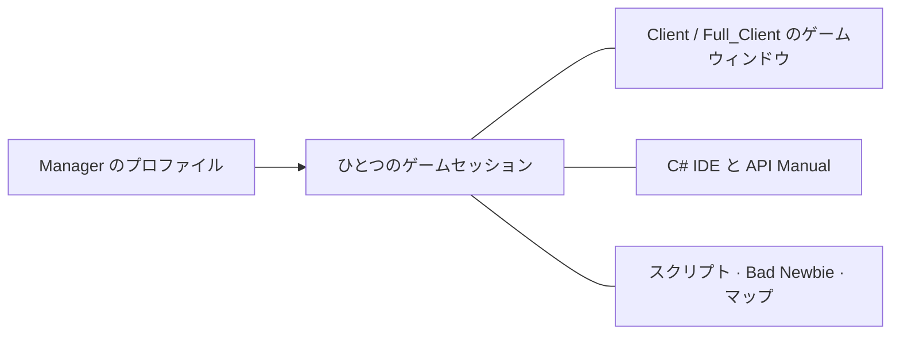

[Українська](../../README.md) · [English](en.md) · [Русский](ru.md) · [Deutsch](de.md) · [Español](es.md) · [Français](fr.md) · [Italiano](it.md) · [日本語](ja.md) · [한국어](ko.md) · [繁體中文](zh-tw.md)

---

# ClassicUO — Bad Newbie & C# Scripts IDE

ひとつにつながった作業環境で Ultima Online をプレイし、キャラクターを整理し、C# スクリプトを作成できます。Bad Newbie は、移動、ドア、戦利品の回収、売買、名前付きリスト、詠唱表示、フォント、アイテムラベルなどに便利な補助機能を追加します。

3 つのアプリケーションは、単独でも組み合わせても使えます。Manager では、プロファイルやグループを管理し、セッションの状態を共通の画面で確認できます。

| アプリケーション | 主な機能 | エディターと共有セッション |
| --- | --- | --- |
| **Manager** | プロファイル、グループ、接続、スクリプト、キャラクターとアイテムのパネル、ジャーナル、マップ | 独自の C# IDE、API Manual、SessionHost を搭載。エディターとヘルプはオフラインでも利用可能 |
| **Full_Client** | Bad Newbie、C# スクリプト、AutoLoad を備えたグラフィカルクライアント | 統合型の C# Scripts IDE を搭載。Manager とも連携可能 |
| **Client** | Bad Newbie、C# スクリプト、AutoLoad を備えたグラフィカルクライアント | 接続中のセッションには Manager の IDE を使用。Full_Client は不要 |



Manager からゲームウィンドウを開くと、キャラクターの既存の接続が使われます。IDE と各パネルも同じセッションを参照します。

## インストールして使い始める

公開されているダウンロードは [リリース](https://github.com/LIHACHTETAN/ClassicUO-Bad-Newbie-CSharp-Scripts-IDE/releases)で確認してください。パッケージ全体を、書き込み可能な新しいフォルダーに展開します。Ultima Online のゲームデータは各自で用意してください。ゲームファイルや個人用プロファイルは含まれていません。

`Manager/ClassicUO.Manager.exe`、`Full_Client/ClassicUO.exe`、または `Client/ClassicUO.exe` を実行します。対象環境は Windows x64 です。配布用ビルドには通常の .NET ランタイムが含まれます。Manager と IDE の画面には Microsoft Edge WebView2 Runtime が必要です。ソースから製品をビルドする場合や、SDK 形式の `.csproj` プロジェクトを扱う場合には .NET 10 SDK が必要です。

更新時は、先にアプリケーションとセッションを終了し、自分のプロファイルとスクリプトを保存してから、パスを確認してください。

## 1. グループとプロファイルを作成する

**Groups** の横にある **+** を押し、名前を入力して **Save** を選びます。グループを選択し、**⋯** メニューから **＋ Profile** を選びます。新しい名前を保存したら、プロファイルの行をダブルクリックして **Profile settings** を開きます。

シャードのアドレス、ポート、UO のバージョン、アカウント、キャラクターを設定します。**Game files folder** には UO データの場所を指定します。**Graphical client** には、このパッケージの `Client/ClassicUO.exe` または `Full_Client/ClassicUO.exe` を指定します。ゲームデータとは別のパスです。

必要に応じて **C# Scripts** と **Bad Newbie** を有効にし、**Script folder (Autoload)** を設定します。プロファイルやグループの **⋯** メニューにはコピー機能もあります。コピー先の設定は独立していますが、保存済みのスクリプトパスは同じコードファイルを参照します。

## 2. キャラクターまたはグループを接続する

目的のプロファイルを選択し、**▶ Connect** を押します。キャラクターの自動入場が無効な場合は、サーバーから取得したキャラクターを選び、**Enter with character** を押します。ワールドへの入場が確認されるまで待ってください。

グループの **⋯** メニューには **Connect entire group** と **Disconnect entire group** があります。これらはゲームセッションを操作します。**Disconnect** は選択したプロファイルの接続とスクリプトを終了します。接続設定の変更は、新しいセッションを開始したときに反映されます。

## 3. オフラインで IDE を開く

未接続の状態で、Manager のサイドバーから **C# IDE** を選びます。Manager には独自のエディターと API Manual が含まれるため、隣に Full_Client をインストールする必要はありません。

**Editor**、**New**、**Open** からソースを開きます。編集、C# の検証、コンパイル、逆コンパイル、ドキュメントの閲覧はオフラインで行えます。ゲームワールドに関わる操作には、接続中のセッションが必要です。

接続済みの Client プロファイルを使う場合、Manager の IDE はその既存のセッションに接続します。

## 4. スクリプトを作成し、検証して実行を操作する

**New → C# (.csx)** を選び、`beginner.csx` として保存します。接続中のデモセッションで、次のコードを試せます。

```csharp
for (int count = 1; count <= 10; count++)
{
    UO.Print($"Hello from C#! Message {count}");
    await WaitAsync(500);
}
```

このコードは、半秒ずつ待ちながら 10 件のメッセージを表示します。`.csx` には `Program` クラスや明示的な `Main` メソッドは必要ありません。

**Save**、**Validate**（**F6**）、**Start**（**F5**）の順に選びます。**Select script run** の一覧で、調査している実行を確認できます。**Pause**（**F7**）は一時停止中に **Continue** に変わります。**Stop**（**Shift+F5**）はキャンセルを要求します。一時停止と停止は制御可能な地点で処理されるため、ブロック中の外部処理は後から終了する場合があります。

| 形式 | 用途 |
| --- | --- |
| `.csx` | `UO`、`WaitAsync`、`Cancellation` などのセッショングローバルを使うスクリプト |
| `.cs` | クラス、`Main`、トップレベルコード、`ICSharpScript` を使う通常の C# ソース |
| `.csproj` | ソース、依存関係、コンパイラー設定を含む SDK プロジェクト |
| `.dll` | 対応するエントリーポイントを持つマネージドスクリプト成果物。ライブラリは参照として利用可能 |
| `.cse` | 保護されたスクリプト。実行時はパスワード不要ですが、Encrypt と Decrypt には必要 |

ツールバーには **Compile**、**Decompile**、**Encrypt**、**Decrypt** もあります。コンパイルしたスクリプトでは、付属の `.dll.csharp.json` と依存ファイルを DLL と一緒に保管してください。Decrypt は、保護されたプロジェクトを選択した空のフォルダーに復元します。

**AutoLoad は別途設定します。** **Choose…**、**Load**、**Unload**、**Reload** は、そのキャラクター用に選択したファイルを管理します。たとえば `Autoload.csx` を選ぶと、そのファイルがキャラクターの AutoLoad 対象になります。エディターで `beginner.csx` を開くだけでは、次回ログイン時のセットには追加されません。Manager では **Scripts → ⋯ → Save set** と、ファイルごとの AutoStart 設定を使います。AutoStart はワールドに入ってから開始します。コードを保存しても、現在の実行は再起動しません。

## 5. コマンドと使用例を探す

Manager または IDE のツールバーから **API Manual** を開きます。`UO.Print` を検索してコマンドを選択し、シグネチャ、パラメーター、戻り値の情報、動作を確認します。**Examples** を開き、**Copy** でコピーします。

マニュアルでは C# の構文、型、ループ、クラス、非同期コードも学べます。言語選択で変わるのは説明文で、C# と UO の識別子は変わりません。デバッグ用ビューには、取得したソースのチェックポイントや変数が表示され、協調的なステップ実行を利用できます。完全な CLR デバッガーではありません。

## 6. 言語と外観を選ぶ

ヘッダーの歯車から **Manager settings → Language and appearance** を開きます。**Interface language** と **Accent color** を選び、**Save** を押します。10 言語に対応しています。Manager は既定のダークテーマを使用し、アクセント色を変更できます。

IDE には、別途 **Theme**、**Accent color** の選択、**Reset accent** があります。言語の反映が保留される場合は、未保存の編集を保存し、フォームを閉じてください。プロファイル名、パス、スクリプトの出力、サーバーメッセージは元の文字列を保持します。

## 7. パネルを分離し、元に戻す

**Map** または **Journal** を開き、見出しの **↗** ボタンを使います。**Dock** を押すと、分離したパネルが Manager に戻ります。

IDE では **Panels** からビューを開き、**Move to separate window** と **Return to IDE** を使います。**Restore layout** は標準の配置を復元します。分離したウィンドウも、選択中のセッションを表示するビューです。

IDE 全体を閉じても、読み込んだファイルと、実行中または一時停止中のスクリプトは保持されます。個別のソースタブを閉じるか **Unload** を選ぶと、そのファイルの処理を停止して実行環境から取り外します。ディスク上のファイルは残ります。

## 8. EnhancedMap の共有を設定する

Manager では **Map → Connection** を使います。Client または Full_Client では、マップ内を右クリックして **EnhancedMap server** を選びます。

**Add** を選び、マップサーバーのプロファイル、アドレス、ポート、ユーザー名を入力して **Save profiles** を押します。マップサーバーのパスワードを入力し、**Connect** を選びます。既定のポートは 8887 ですが、管理者から指定された実際の設定を使用してください。ゲームのシャードとは別の接続です。

対応する EnhancedMap 2 または 3 サーバーでは、同じルームの **Participants**、共有ラベル、チャット、通知を利用できます。**Show on map** はカメラを中央に合わせ、**Track on map** は自分のキャラクターを動かさずに参加者を追跡表示します。管理操作の権限はサーバーの役割によって決まります。マップ接続が Online であることだけでは、ゲーム内の位置が取得できているとは確認できません。

## 9. ゲームウィンドウを開き直す

接続済みの Manager プロファイルで、プロファイルまたはカードの **⋯** メニューから **▶ Open game client** を選びます。その **C# IDE** を開くと、同じスクリプトを確認できます。

**Close game window** は表示だけを閉じ、Manager が所有する接続とスクリプトは続行します。再度開けば、同じセッションに戻れます。**Disconnect** はセッションを終了します。Manager をトレイに格納する通常の終了操作と、所有する全セッションを明示的に終了する **Exit — disconnect all profiles** は異なります。

コマンドの詳しい動作や使用例は、[日本語 Wiki](https://github.com/LIHACHTETAN/ClassicUO-Bad-Newbie-CSharp-Scripts-IDE/wiki/JA-Home)で確認できます。

元のクライアント：[ClassicUO Team](https://github.com/ClassicUO/ClassicUO)。Manager、Bad Newbie、C# IDE の改良：[Bad Newbie プロジェクト](https://github.com/LIHACHTETAN/ClassicUO-Bad-Newbie-CSharp-Scripts-IDE)。
