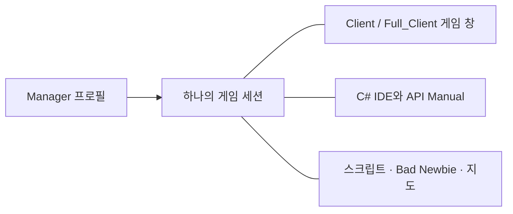

[Українська](../../README.md) · [English](en.md) · [Русский](ru.md) · [Deutsch](de.md) · [Español](es.md) · [Français](fr.md) · [Italiano](it.md) · [日本語](ja.md) · [한국어](ko.md) · [繁體中文](zh-tw.md)

---

# ClassicUO — Bad Newbie & C# Scripts IDE

하나로 연결된 작업 공간에서 Ultima Online을 플레이하고, 캐릭터를 정리하고, C# 스크립트를 작성하세요. Bad Newbie는 이동, 문, 전리품 수집, 물건 구매와 판매, 이름이 있는 목록, 주문 시전 표시, 글꼴, 아이템 이름표 등에 유용한 보조 기능을 추가합니다.

세 애플리케이션은 각각 독립적으로 사용하거나 함께 사용할 수 있습니다. Manager는 프로필과 그룹을 관리하고 세션 상태를 함께 살펴볼 수 있는 화면을 제공합니다.

| 애플리케이션 | 제공 기능 | 편집기와 공유 세션 |
| --- | --- | --- |
| **Manager** | 프로필, 그룹, 연결, 스크립트, 캐릭터와 아이템 패널, 저널, 지도 | 자체 C# IDE, API Manual, SessionHost 제공. 편집기와 도움말은 오프라인에서도 사용 가능 |
| **Full_Client** | Bad Newbie, C# 스크립트, AutoLoad가 포함된 그래픽 클라이언트 | 자체 통합 C# Scripts IDE 제공. Manager와 함께 사용 가능 |
| **Client** | Bad Newbie, C# 스크립트, AutoLoad가 포함된 그래픽 클라이언트 | 실행 중인 세션에는 Manager의 IDE를 사용. Full_Client는 필요 없음 |



Manager에서 게임 창을 열면 캐릭터의 기존 연결을 사용합니다. IDE와 패널도 그와 동일한 세션을 참조합니다.

## 설치하고 시작 방법 선택하기

공개된 다운로드는 [릴리스](https://github.com/LIHACHTETAN/ClassicUO-Bad-Newbie-CSharp-Scripts-IDE/releases)에서 확인하세요. 전체 패키지를 쓰기 가능한 새 폴더에 압축 해제합니다. Ultima Online 게임 데이터는 직접 준비해야 합니다. 게임 파일과 개인 프로필은 패키지에 포함되어 있지 않습니다.

`Manager/ClassicUO.Manager.exe`, `Full_Client/ClassicUO.exe` 또는 `Client/ClassicUO.exe`를 실행합니다. 지원 대상은 Windows x64입니다. 배포용 빌드에는 일반 .NET 런타임이 포함됩니다. Manager와 IDE 인터페이스에는 Microsoft Edge WebView2 Runtime이 필요합니다. 소스에서 제품을 빌드하거나 SDK 형식의 `.csproj` 프로젝트를 사용하려면 .NET 10 SDK가 필요합니다.

업데이트할 때는 먼저 애플리케이션과 세션을 종료하고, 프로필과 스크립트를 보관한 다음 경로를 확인하세요.

## 1. 그룹과 프로필 만들기

**Groups** 옆의 **+**를 누르고 이름을 입력한 뒤 **Save**를 선택합니다. 그룹을 선택하고 **⋯** 메뉴를 열어 **＋ Profile**을 선택합니다. 새 이름을 저장한 다음 프로필 행을 두 번 클릭하여 **Profile settings**를 엽니다.

샤드 주소, 포트, UO 버전, 계정, 캐릭터를 설정합니다. **Game files folder**에는 UO 데이터 경로를 지정합니다. **Graphical client**에는 이 패키지의 `Client/ClassicUO.exe` 또는 `Full_Client/ClassicUO.exe`를 선택합니다. 게임 데이터 폴더와는 별도의 경로입니다.

필요에 따라 **C# Scripts**, **Bad Newbie**, **Script folder (Autoload)**를 설정하세요. 프로필과 그룹의 **⋯** 메뉴에는 복사 기능도 있습니다. 복사본은 별도의 설정을 가지지만, 저장된 스크립트 경로는 여전히 같은 코드 파일을 가리킵니다.

## 2. 캐릭터 또는 그룹 연결하기

사용할 프로필을 선택하고 **▶ Connect**를 누릅니다. 캐릭터 자동 입장이 꺼져 있으면 서버가 반환한 캐릭터 중 하나를 선택하고 **Enter with character**를 누릅니다. 월드 입장이 확인될 때까지 기다리세요.

그룹의 **⋯** 메뉴에는 **Connect entire group**과 **Disconnect entire group**이 있습니다. 이 기능은 게임 세션을 대상으로 합니다. **Disconnect**는 선택한 프로필의 연결과 스크립트를 종료합니다. 연결 설정을 변경하면 새 세션을 시작한 뒤 적용됩니다.

## 3. 오프라인에서 IDE 열기

연결되지 않은 상태에서 Manager 사이드바의 **C# IDE**를 선택합니다. Manager에는 자체 편집기와 API Manual이 있으므로 옆에 Full_Client를 설치할 필요가 없습니다.

**Editor**, **New**, **Open**으로 소스에 접근합니다. 편집, C# 유효성 검사, 컴파일, 디컴파일, 문서 열람은 오프라인에서도 가능합니다. 게임 월드와 관련된 작업에는 활성 세션이 필요합니다.

Client 프로필이 연결되어 있으면 Manager의 IDE는 그 기존 세션에 연결됩니다.

## 4. 스크립트 작성, 검사 및 실행 제어하기

**New → C# (.csx)**를 선택하고 `beginner.csx`로 저장합니다. 활성 시연 세션에서 다음 코드를 실행해 보세요.

```csharp
for (int count = 1; count <= 10; count++)
{
    UO.Print($"Hello from C#! Message {count}");
    await WaitAsync(500);
}
```

이 코드는 메시지를 열 번 출력하며 각 메시지 사이에 0.5초를 기다립니다. `.csx`에는 `Program` 클래스나 명시적인 `Main` 메서드가 필요하지 않습니다.

**Save**, **Validate**(**F6**), **Start**(**F5**) 순서로 선택합니다. **Select script run** 목록은 현재 살펴보는 실행 항목을 나타냅니다. **Pause**(**F7**)는 일시 정지 중에 **Continue**로 바뀌며, **Stop**(**Shift+F5**)은 취소를 요청합니다. 일시 정지와 중지는 제어 가능한 지점에서 처리되므로 외부의 블로킹 작업은 나중에 끝날 수 있습니다.

| 형식 | 용도 |
| --- | --- |
| `.csx` | `UO`, `WaitAsync`, `Cancellation` 같은 세션 전역 변수를 사용하는 스크립트 |
| `.cs` | 클래스, `Main`, 최상위 코드 또는 `ICSharpScript`를 사용하는 일반 C# 소스 |
| `.csproj` | 소스, 종속성, 컴파일러 설정을 포함하는 SDK 프로젝트 |
| `.dll` | 지원되는 진입점이 있는 관리형 스크립트 결과물. 라이브러리를 참조할 수 있음 |
| `.cse` | 보호된 스크립트. 실행에는 암호가 필요 없지만 Encrypt와 Decrypt에는 필요함 |

도구 모음에는 **Compile**, **Decompile**, **Encrypt**, **Decrypt**도 있습니다. 컴파일된 스크립트의 `.dll.csharp.json` 보조 파일과 종속성을 해당 DLL과 함께 보관하세요. Decrypt는 보호된 프로젝트를 선택한 빈 폴더에 복원합니다.

**AutoLoad는 따로 선택합니다.** **Choose…**, **Load**, **Unload**, **Reload** 컨트롤은 캐릭터에 선택된 파일을 관리합니다. 예를 들어 `Autoload.csx` 파일을 선택하면 그 파일이 캐릭터의 AutoLoad 항목이 됩니다. 편집기에서 `beginner.csx`를 여는 것만으로 다음 로그인용 집합에 추가되지는 않습니다. Manager에서는 **Scripts → ⋯ → Save set**과 파일별 AutoStart 설정을 사용하세요. AutoStart는 월드에 입장한 뒤 시작합니다. 코드를 저장해도 현재 실행이 다시 시작되지는 않습니다.

## 5. 명령과 예제 찾기

Manager 또는 IDE 도구 모음에서 **API Manual**을 엽니다. `UO.Print`를 검색하고 명령을 선택한 뒤 시그니처, 매개변수, 반환 정보, 동작을 읽습니다. **Examples**를 열고 **Copy**를 사용합니다.

매뉴얼에서는 C# 문법, 형식, 반복문, 클래스, 비동기 코드도 배울 수 있습니다. 언어 선택기는 설명을 바꾸며 C#과 UO 식별자는 바꾸지 않습니다. 디버그 뷰는 수집된 소스 체크포인트와 변수를 보여 주고 협력적 단계 실행을 제공합니다. 완전한 CLR 디버거는 아닙니다.

## 6. 언어와 모양 선택하기

헤더의 톱니바퀴를 눌러 **Manager settings → Language and appearance**를 엽니다. **Interface language**와 **Accent color**를 선택한 뒤 **Save**를 누릅니다. 열 가지 언어를 사용할 수 있습니다. Manager는 기본 어두운 테마를 사용하며 강조색을 설정할 수 있습니다.

IDE에는 별도로 **Theme**, **Accent color** 선택기, **Reset accent**가 있습니다. 언어 갱신이 미뤄지면 보류 중인 편집 내용을 저장하고 양식을 닫으세요. 프로필 이름, 경로, 스크립트 출력, 서버 메시지는 원래 텍스트를 유지합니다.

## 7. 패널 분리 및 배치 복원하기

**Map** 또는 **Journal**을 열고 제목 부분의 **↗** 컨트롤을 사용합니다. **Dock**은 분리된 패널을 Manager로 돌려놓습니다.

IDE에서는 **Panels**를 통해 뷰를 열고 **Move to separate window**와 **Return to IDE**를 사용합니다. **Restore layout**은 기본 배치를 복원합니다. 분리된 창도 선택한 세션을 보여 주는 뷰입니다.

IDE 전체를 닫아도 로드된 파일과 실행 중이거나 일시 정지된 스크립트는 유지됩니다. 개별 소스 탭을 닫거나 **Unload**를 선택하면 해당 파일의 프로시저가 중지되고 런타임에서 제거됩니다. 디스크의 파일은 그대로 남습니다.

## 8. EnhancedMap 공유 설정하기

Manager에서는 **Map → Connection**을 사용합니다. Client 또는 Full_Client에서는 지도 안을 마우스 오른쪽 버튼으로 클릭하고 **EnhancedMap server**를 선택합니다.

**Add**를 선택하고 지도 서버의 프로필, 주소, 포트, 사용자 이름을 입력한 다음 **Save profiles**를 누릅니다. 지도 서버 암호를 입력하고 **Connect**를 선택합니다. 기본 포트는 8887이며 관리자가 제공한 실제 설정을 사용해야 합니다. 게임 샤드 연결과는 별개의 연결입니다.

호환되는 EnhancedMap 2 또는 3 서버는 같은 방의 **Participants**, 공유 이름표, 채팅, 알림을 제공합니다. **Show on map**은 카메라를 가운데로 맞추고, **Track on map**은 내 캐릭터를 이동시키지 않고 참가자를 따라 화면을 표시합니다. 관리 기능은 서버 역할에 따라 결정됩니다. 지도 연결이 Online이라는 사실만으로 게임 내 위치가 제공된다고 확인할 수는 없습니다.

## 9. 그래픽 창 다시 열기

연결된 Manager 프로필에서 프로필 또는 카드의 **⋯** 메뉴를 열고 **▶ Open game client**를 선택합니다. 해당 **C# IDE**를 열면 같은 스크립트를 살펴볼 수 있습니다.

**Close game window**는 그 화면을 닫으며 Manager가 소유하는 연결과 스크립트는 계속됩니다. 다시 열면 같은 세션으로 돌아옵니다. **Disconnect**는 세션을 종료합니다. Manager를 트레이로 닫는 동작은 소유한 세션을 명시적으로 모두 종료하는 **Exit — disconnect all profiles**와 다릅니다.

명령의 자세한 동작과 예제는 [한국어 Wiki](https://github.com/LIHACHTETAN/ClassicUO-Bad-Newbie-CSharp-Scripts-IDE/wiki/KO-Home)에서 이어서 확인하세요.

원본 클라이언트: [ClassicUO Team](https://github.com/ClassicUO/ClassicUO). Manager, Bad Newbie, C# IDE 수정: [Bad Newbie 프로젝트](https://github.com/LIHACHTETAN/ClassicUO-Bad-Newbie-CSharp-Scripts-IDE).
