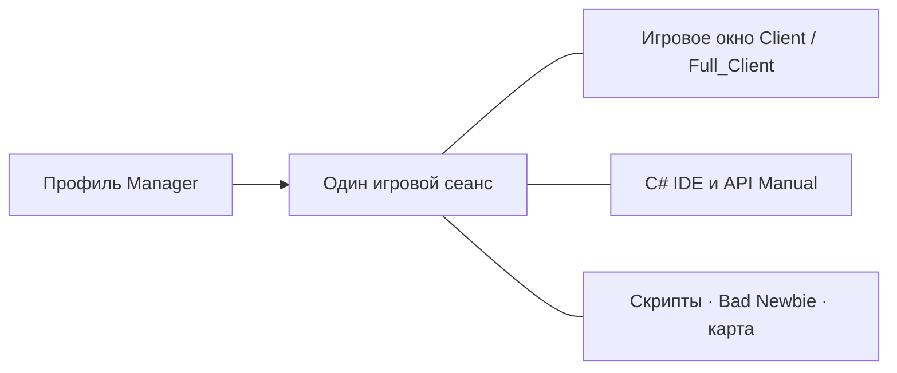

[Українська](../../README.md) · [English](en.md) · [Русский](ru.md) · [Deutsch](de.md) · [Español](es.md) · [Français](fr.md) · [Italiano](it.md) · [日本語](ja.md) · [한국어](ko.md) · [繁體中文](zh-tw.md)

---

# ClassicUO — Bad Newbie & C# Scripts IDE

Играйте в Ultima Online, управляйте персонажами и пишите C#-скрипты в общем рабочем пространстве. Bad Newbie добавляет помощь с движением, дверями, сбором добычи, покупкой и продажей, именованными списками, индикаторами заклинаний, шрифтами и подписями предметов.

Три программы работают отдельно и вместе. Manager добавляет профили, группы и общее управление сеансами.

| Программа | Что предоставляет | Редактор и общие сеансы |
| --- | --- | --- |
| **Manager** | Профили, группы, подключения, скрипты, панели персонажа и предметов, журналы и карту | Собственные C# IDE, API Manual и SessionHost; редактор и справка работают офлайн |
| **Full_Client** | Графический клиент с Bad Newbie, C#-скриптами и AutoLoad | Собственный встроенный C# Scripts IDE; также работает с Manager |
| **Client** | Графический клиент с Bad Newbie, C#-скриптами и AutoLoad | Manager предоставляет IDE для его действующего сеанса; Full_Client не нужен |



Открытие игрового окна из Manager использует уже существующее подключение персонажа. IDE и панели работают с тем же сеансом.

## Установка и первый запуск

Проверьте опубликованные загрузки в [Releases](https://github.com/LIHACHTETAN/ClassicUO-Bad-Newbie-CSharp-Scripts-IDE/releases). Полностью распакуйте комплект в новую папку с правом записи. Добавьте собственные игровые данные Ultima Online: файлы игры и личные профили в комплект не входят.

Запустите `Manager/ClassicUO.Manager.exe`, `Full_Client/ClassicUO.exe` или `Client/ClassicUO.exe`. Целевая платформа — Windows x64. Готовые сборки включают обычную среду выполнения .NET; интерфейсам Manager и IDE нужен Microsoft Edge WebView2 Runtime. Для сборки программы из исходного кода и работы с SDK-проектами `.csproj` требуется .NET 10 SDK.

Перед обновлением закройте программы и сеансы, сохраните собственные профили и скрипты, а после переноса проверьте пути.

## 1. Создайте группы и профили

Нажмите **+** рядом с **Groups**, введите название и выберите **Save**. Выберите группу, откройте её меню **⋯** и нажмите **＋ Profile**. Сохраните имя профиля, затем дважды щёлкните его строку, чтобы открыть **Profile settings**.

Укажите адрес шарда, порт, версию UO, аккаунт и персонажа. **Game files folder** — папка ваших данных UO. **Graphical client** выбирает `Client/ClassicUO.exe` или `Full_Client/ClassicUO.exe` из этого комплекта; это отдельный путь.

При необходимости настройте **C# Scripts**, **Bad Newbie** и **Script folder (Autoload)**. Меню **⋯** профиля и группы также содержат копирование. Копии имеют отдельные настройки, но сохранённые пути скриптов по-прежнему ведут к тем же файлам кода.

## 2. Подключите персонажа или группу

Выберите нужный профиль и нажмите **▶ Connect**. Если автоматический вход выключен, выберите персонажа из списка сервера и нажмите **Enter with character**. Дождитесь подтверждённого входа в мир.

В меню группы **⋯** доступны **Connect entire group** и **Disconnect entire group**. Эти действия управляют игровыми сеансами. **Disconnect** завершает подключение и скрипты выбранного профиля. Изменения параметров подключения применяются после запуска нового сеанса.

## 3. Откройте IDE офлайн

Без подключения выберите **C# IDE** в боковой панели Manager. Manager содержит собственные редактор и API Manual; соседняя папка Full_Client не нужна.

Откройте код через **Editor**, **New** или **Open**. Редактирование, проверка C#, компиляция, декомпиляция и справка доступны офлайн. Действия с игровым миром требуют активного сеанса.

Для подключённого профиля Client редактор Manager присоединяется к уже существующему сеансу.

## 4. Напишите, проверьте и запустите скрипт

Выберите **New → C# (.csx)** и сохраните `beginner.csx`. В активном учебном сеансе попробуйте:

```csharp
for (int count = 1; count <= 10; count++)
{
    UO.Print($"Hello from C#! Message {count}");
    await WaitAsync(500);
}
```

Скрипт выведет десять сообщений с полусекундной задержкой между ними. Для `.csx` не нужны класс `Program` или явно объявленный метод `Main`.

Нажмите **Save**, **Validate** (**F6**), затем **Start** (**F5**). Список **Select script run** определяет запуск, который вы просматриваете. **Pause** (**F7**) во время паузы меняется на **Continue**; **Stop** (**Shift+F5**) запрашивает отмену. Пауза и остановка действуют в контролируемых точках, поэтому сторонний блокирующий вызов может завершиться позже.

| Формат | Назначение |
| --- | --- |
| `.csx` | Скрипт с переменными сеанса, включая `UO`, `WaitAsync` и `Cancellation` |
| `.cs` | Обычный исходный код C# с классами, `Main`, операторами верхнего уровня или `ICSharpScript` |
| `.csproj` | SDK-проект со своими исходными файлами, зависимостями и настройками компилятора |
| `.dll` | Управляемый артефакт скрипта с поддерживаемой точкой входа; библиотеки можно подключать |
| `.cse` | Защищённый скрипт: запускается без пароля; Encrypt и Decrypt требуют пароль |

Панель также содержит **Compile**, **Decompile**, **Encrypt** и **Decrypt**. Вместе с DLL скомпилированного скрипта сохраняйте сопутствующий `.dll.csharp.json` и зависимости. Decrypt восстанавливает защищённый проект в выбранную пустую папку.

**AutoLoad выбирается отдельно.** Кнопки **Choose…**, **Load**, **Unload** и **Reload** управляют выбранным файлом персонажа. Например, выбор `Autoload.csx` делает его файлом AutoLoad этого персонажа. Открытие `beginner.csx` в редакторе само по себе не добавляет его в набор следующего входа. В Manager используйте **Scripts → ⋯ → Save set** и AutoStart для каждого файла. AutoStart начинается после входа в мир. Сохранение кода не перезапускает его текущее выполнение.

## 5. Найдите команду и пример

Откройте **API Manual** из Manager или панели IDE. Найдите `UO.Print`, выберите команду и просмотрите сигнатуры, параметры, результат и поведение. Откройте **Examples** и воспользуйтесь **Copy**.

Справочник также объясняет синтаксис C#, типы, циклы, классы и асинхронный код. Переключатель языка меняет объяснения; идентификаторы C# и UO остаются неизменными. Панели отладки показывают захваченные переменные и контрольные точки кода, поддерживая кооперативные шаги; это не полный отладчик CLR.

## 6. Выберите язык и оформление

Нажмите шестерёнку вверху: **Manager settings → Language and appearance**. Выберите **Interface language** и **Accent color**, затем **Save**. Доступны десять языков. Manager использует стандартную тёмную тему с настраиваемым акцентом.

IDE отдельно предлагает **Theme**, выбор **Accent color** и **Reset accent**. Если обновление языка отложено, сохраните незавершённые изменения и закройте формы. Имена профилей, пути, вывод скриптов и серверные сообщения сохраняют исходный текст.

## 7. Отделите и верните панели

Откройте **Map** или **Journal** и нажмите **↗** в заголовке. **Dock** возвращает отделённую панель Manager.

В IDE откройте раздел через **Panels**, выберите **Move to separate window**, затем **Return to IDE**. **Restore layout** возвращает стандартное расположение. Отдельные окна остаются представлениями выбранного сеанса.

Закрытие всей IDE сохраняет загруженные файлы и работающие или приостановленные скрипты. Закрытие отдельной вкладки кода или **Unload** останавливает процедуры этого файла и убирает его из runtime; файл на диске остаётся.

## 8. Настройте общую карту EnhancedMap

В Manager выберите **Map → Connection**. В Client или Full_Client щёлкните правой кнопкой внутри карты и выберите **EnhancedMap server**.

Нажмите **Add**, укажите профиль сервера карты, адрес, порт и имя пользователя, затем **Save profiles**. Введите пароль сервера карты и нажмите **Connect**. Порт по умолчанию — 8887; используйте данные администратора. Это отдельное подключение, отличающееся от входа на игровой шард.

Совместимый сервер EnhancedMap 2 или 3 предоставляет **Participants** той же комнаты, общие метки, чат и сигналы. **Show on map** центрирует камеру; **Track on map** следит за участником, не двигая вашего персонажа. Администрирование зависит от роли сервера. Состояние Online карты само по себе не подтверждает наличие игровой позиции.

## 9. Повторно откройте игровое окно

Для подключённого профиля Manager откройте меню **⋯** профиля или карточки и выберите **▶ Open game client**. Откройте его **C# IDE**, чтобы просмотреть те же скрипты.

**Close game window** закрывает представление, но подключение и скрипты сеанса Manager продолжают работать. Откройте окно снова, чтобы вернуться к тому же сеансу. **Disconnect** завершает сеанс. Сворачивание Manager в трей отличается от **Exit — disconnect all profiles**, которое явно завершает его собственные сеансы.

Подробное поведение команд и примеры ищите в [русской Wiki](https://github.com/LIHACHTETAN/ClassicUO-Bad-Newbie-CSharp-Scripts-IDE/wiki/RU-Home).

Оригинальный клиент: [ClassicUO Team](https://github.com/ClassicUO/ClassicUO). Изменения Manager, Bad Newbie и C# IDE: [проект Bad Newbie](https://github.com/LIHACHTETAN/ClassicUO-Bad-Newbie-CSharp-Scripts-IDE).
