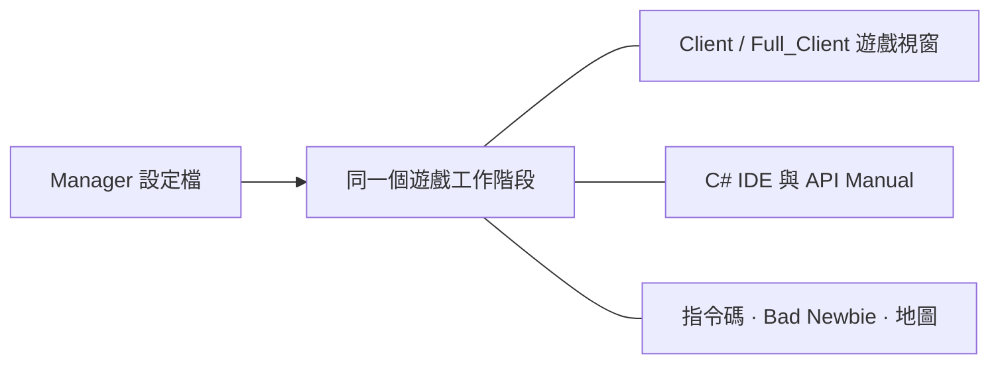

[Українська](../../README.md) · [English](en.md) · [Русский](ru.md) · [Deutsch](de.md) · [Español](es.md) · [Français](fr.md) · [Italiano](it.md) · [日本語](ja.md) · [한국어](ko.md) · [繁體中文](zh-tw.md)

---

# ClassicUO — Bad Newbie & C# Scripts IDE

在同一個彼此連通的工作環境中遊玩 Ultima Online、管理角色並撰寫 C# 指令碼。Bad Newbie 為移動、開門、拾取戰利品、買賣、具名清單、施法指示、字型與物品標籤等操作提供實用的輔助功能。

這三個應用程式可以獨立使用，也能搭配運作。Manager 提供設定檔、群組，以及統一檢視工作階段的介面。

| 應用程式 | 提供的功能 | 編輯器與共用工作階段 |
| --- | --- | --- |
| **Manager** | 設定檔、群組、連線、指令碼、角色與物品面板、日誌及地圖 | 內建自己的 C# IDE、API Manual 與 SessionHost；編輯器和說明可離線使用 |
| **Full_Client** | 具備 Bad Newbie、C# 指令碼與 AutoLoad 的圖形用戶端 | 內建整合式 C# Scripts IDE，也能搭配 Manager 使用 |
| **Client** | 具備 Bad Newbie、C# 指令碼與 AutoLoad 的圖形用戶端 | 由 Manager 為執行中的工作階段提供 IDE，無須 Full_Client |



從 Manager 開啟遊戲視窗時，會使用角色現有的連線。IDE 與各面板也會存取同一個工作階段。

## 安裝並選擇起點

請至[發行版本](https://github.com/LIHACHTETAN/ClassicUO-Bad-Newbie-CSharp-Scripts-IDE/releases)查看已公開的下載項目。將完整套件解壓縮到新的可寫入資料夾。Ultima Online 遊戲資料需要自行準備；套件不包含遊戲檔案與個人設定檔。

執行 `Manager/ClassicUO.Manager.exe`、`Full_Client/ClassicUO.exe` 或 `Client/ClassicUO.exe`。目標平台為 Windows x64。預先建置的版本包含一般 .NET 執行階段；Manager 與 IDE 的介面需要 Microsoft Edge WebView2 Runtime。若要從原始碼建置產品，或使用 SDK 格式的 `.csproj` 專案，則需要 .NET 10 SDK。

更新時，請先關閉應用程式與工作階段，保留自己的設定檔與指令碼，再檢查各項路徑。

## 1. 建立群組與設定檔

按下 **Groups** 旁的 **+**，輸入名稱並選擇 **Save**。選取群組，開啟它的 **⋯** 選單，再選擇 **＋ Profile**。儲存新名稱後，按兩下設定檔所在列以開啟 **Profile settings**。

設定遊戲伺服器位址、連接埠、UO 版本、帳號與角色。**Game files folder** 指向 UO 資料所在位置。**Graphical client** 則選擇本套件的 `Client/ClassicUO.exe` 或 `Full_Client/ClassicUO.exe`；這是另一項獨立的路徑設定。

視需要啟用 **C# Scripts**、**Bad Newbie**，並設定 **Script folder (Autoload)**。設定檔與群組的 **⋯** 選單也提供複製功能。複本有獨立的設定，但已儲存的指令碼路徑仍指向同一批程式碼檔案。

## 2. 連線角色或整個群組

選取要使用的設定檔並按下 **▶ Connect**。如果未啟用角色自動進入遊戲，請從伺服器傳回的角色中選取一個，再按下 **Enter with character**。等待確認已進入遊戲世界。

群組的 **⋯** 選單提供 **Connect entire group** 與 **Disconnect entire group**。這些操作會影響遊戲工作階段。**Disconnect** 會結束所選設定檔的連線與指令碼。連線設定的變更會在啟動新的工作階段後生效。

## 3. 離線開啟 IDE

在尚未連線時，從 Manager 側邊欄選擇 **C# IDE**。Manager 包含自己的編輯器與 API Manual，無須在旁邊另外安裝 Full_Client。

使用 **Editor**、**New** 或 **Open** 開啟原始碼。編輯、C# 驗證、編譯、反編譯與文件查閱都能離線進行。涉及遊戲世界的操作則需要使用中的工作階段。

如果 Client 設定檔已連線，Manager 的 IDE 會連接到該既有工作階段。

## 4. 撰寫、驗證並控制指令碼

選擇 **New → C# (.csx)**，並儲存為 `beginner.csx`。在已啟用的示範工作階段中，可以試用以下程式碼：

```csharp
for (int count = 1; count <= 10; count++)
{
    UO.Print($"Hello from C#! Message {count}");
    await WaitAsync(500);
}
```

這段程式碼會輸出十則訊息，每則之間等待半秒。`.csx` 不需要 `Program` 類別，也不需要明確宣告 `Main` 方法。

依序選擇 **Save**、**Validate**（**F6**）與 **Start**（**F5**）。**Select script run** 清單會指出目前正在檢視的執行個體。**Pause**（**F7**）會在暫停時變成 **Continue**；**Stop**（**Shift+F5**）則會提出取消要求。暫停與停止會在可控制的位置生效，因此外部的阻塞作業可能稍後才會結束。

| 格式 | 用途 |
| --- | --- |
| `.csx` | 使用 `UO`、`WaitAsync`、`Cancellation` 等工作階段全域物件的指令碼 |
| `.cs` | 使用類別、`Main`、最上層程式碼或 `ICSharpScript` 的一般 C# 原始碼 |
| `.csproj` | 包含原始碼、相依性與編譯器設定的 SDK 專案 |
| `.dll` | 具有受支援進入點的受控指令碼產物；可參考程式庫作為相依性 |
| `.cse` | 受保護的指令碼；執行時不需密碼，但 Encrypt 與 Decrypt 都需要密碼 |

工具列也提供 **Compile**、**Decompile**、**Encrypt** 與 **Decrypt**。請將已編譯指令碼的 `.dll.csharp.json` 配套檔案與相依性，一起保留在 DLL 旁。Decrypt 會將受保護的專案還原至所選的空資料夾。

**AutoLoad 需要另外選擇。** 它的 **Choose…**、**Load**、**Unload** 與 **Reload** 控制項會管理為角色選取的檔案。例如，選取 `Autoload.csx`，就會讓該檔案成為角色的 AutoLoad 項目。僅在編輯器中開啟 `beginner.csx`，並不會將它加入下次登入時使用的集合。在 Manager 中，請使用 **Scripts → ⋯ → Save set** 與各檔案的 AutoStart 選項。AutoStart 會在角色進入世界後啟動。儲存程式碼不會重新啟動目前的執行個體。

## 5. 尋找命令與範例

從 Manager 或 IDE 工具列開啟 **API Manual**。搜尋 `UO.Print`，選取命令，再閱讀其簽章、參數、傳回資訊與行為。開啟 **Examples**，並使用 **Copy** 複製。

手冊也會介紹 C# 語法、型別、迴圈、類別與非同步程式碼。語言選擇器會變更說明文字，C# 與 UO 識別名稱則保持不變。偵錯檢視會顯示擷取的原始碼檢查點與變數，並提供協作式逐步執行；這並不是完整的 CLR 偵錯工具。

## 6. 選擇語言與外觀

按下頁首的齒輪，開啟 **Manager settings → Language and appearance**。選擇 **Interface language** 與 **Accent color**，再按 **Save**。共有十種語言可用。Manager 使用預設的深色佈景主題，並可設定強調色。

IDE 另有自己的 **Theme**、**Accent color** 色彩選擇器與 **Reset accent**。如果語言更新暫緩套用，請儲存尚未完成的編輯，並關閉表單。設定檔名稱、路徑、指令碼輸出與伺服器訊息都會保留原文。

## 7. 分離面板與還原配置

開啟 **Map** 或 **Journal**，並使用標題列的 **↗** 控制項。**Dock** 會將分離的面板放回 Manager。

在 IDE 中，透過 **Panels** 開啟檢視，再使用 **Move to separate window** 與 **Return to IDE**。**Restore layout** 會還原標準配置。分離的視窗仍然是所選工作階段的檢視。

關閉整個 IDE 會保留已載入的檔案，以及執行中或暫停中的指令碼。關閉單一原始碼分頁，或選擇 **Unload**，則會停止該檔案的程序，並將它從執行階段移除；磁碟上的檔案仍會保留。

## 8. 設定 EnhancedMap 共享功能

在 Manager 中使用 **Map → Connection**。在 Client 或 Full_Client 中，於地圖內按滑鼠右鍵，再選擇 **EnhancedMap server**。

選擇 **Add**，填入地圖伺服器的設定檔、位址、連接埠與使用者名稱，再按 **Save profiles**。輸入地圖伺服器密碼並選擇 **Connect**。預設連接埠是 8887，請使用管理員提供的實際設定。這是另一條連線，與遊戲伺服器的連線分開。

相容的 EnhancedMap 2 或 3 伺服器會提供同一房間內的 **Participants**、共享標籤、聊天與警示。**Show on map** 會將鏡頭置中；**Track on map** 會跟隨參與者的位置顯示鏡頭，但不會移動自己的角色。管理功能由伺服器角色決定。地圖連線顯示 Online，並不代表已取得可用的遊戲位置。

## 9. 重新開啟圖形視窗

對於已連線的 Manager 設定檔，開啟設定檔或卡片的 **⋯** 選單，選擇 **▶ Open game client**。開啟它的 **C# IDE**，即可檢視同一批指令碼。

**Close game window** 會關閉該檢視，而由 Manager 管理的連線與指令碼仍會繼續。重新開啟即可回到同一個工作階段。**Disconnect** 會結束工作階段。將 Manager 關閉至系統匣，與 **Exit — disconnect all profiles** 不同；後者會明確結束 Manager 所管理的所有工作階段。

如需命令的詳細行為與範例，請繼續閱讀[繁體中文 Wiki](https://github.com/LIHACHTETAN/ClassicUO-Bad-Newbie-CSharp-Scripts-IDE/wiki/ZH-TW-Home)。

原始用戶端：[ClassicUO Team](https://github.com/ClassicUO/ClassicUO)。Manager、Bad Newbie 與 C# IDE 的修改：[Bad Newbie 專案](https://github.com/LIHACHTETAN/ClassicUO-Bad-Newbie-CSharp-Scripts-IDE)。
